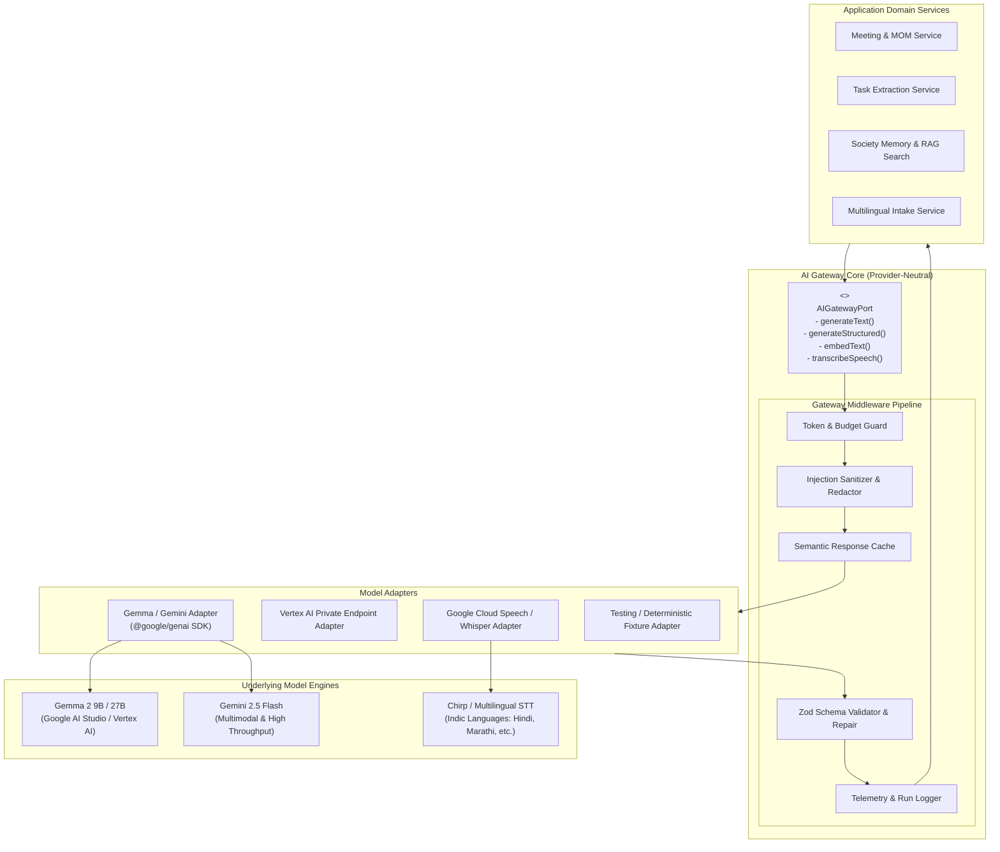
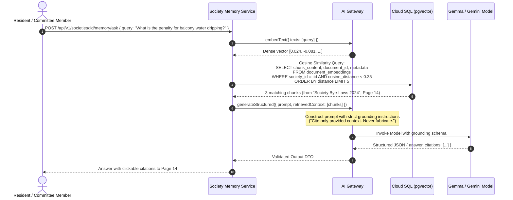

# SocietyFix AI — Provider-Neutral AI Gateway & Intelligence Architecture

> **Document ID:** AI-001  
> **Status:** Approved / Milestone M0 Baseline  
> **Core Model Baseline:** Google Gemma 2 / Gemini via `@google/genai` SDK  
> **Primary Interfaces:** `generateText`, `generateStructured`, `embedText`, `transcribeSpeech`

---

## 1. Design Tenets & Abstraction Philosophy

1. **Provider Neutrality:** The application core must never be tightly coupled to a single vendor's SDK or proprietary endpoints. All AI capabilities are accessed via an abstract, pluggable interface (`AIGatewayPort`).
2. **Guaranteed Structured Outputs:** Complex outputs (meeting minutes, task decomposition, invoice extraction) must conform to deterministic TypeScript types verified at runtime using `zod` schemas. If a model output fails validation, the gateway automatically retries with repair instructions.
3. **Grounding & Source Citations:** AI responses to natural language queries must include explicit, inspectable references to the source documents (meeting ID, paragraph index, circular number). Responses without high-confidence grounding are rejected.
4. **Safety as a First Principle:** The AI gateway enforces a strict barrier between generation and database commits. AI outputs are labeled `is_ai_draft = true` and cannot directly execute financial disbursements, grant roles, or pass statutory resolutions.
5. **Budget & Rate Quota Enforcement:** Token usage is metered per society per billing cycle. Graceful degradation prevents cost overruns.

---

## 2. AI Gateway Architecture & Port/Adapter Topology



---

## 3. Core Gateway Interfaces (TypeScript)

```typescript
import { z } from 'zod';

export interface PromptContext {
  societyId: string;
  userId: string;
  operationName: string;
  temperature?: number;
  maxTokens?: number;
  timeoutMs?: number;
}

export interface TextGenerationRequest extends PromptContext {
  systemPrompt: string;
  userPrompt: string;
  retrievedContext?: string[];
}

export interface StructuredGenerationRequest<T> extends PromptContext {
  systemPrompt: string;
  userPrompt: string;
  schema: z.ZodSchema<T>;
  schemaName: string;
  schemaDescription: string;
  retrievedContext?: string[];
  maxRetries?: number;
}

export interface EmbeddingRequest {
  societyId: string;
  texts: string[];
  model?: string;
}

export interface TranscriptionRequest {
  societyId: string;
  userId: string;
  audioBuffer: Buffer;
  mimeType: string;
  languageHint?: string; // 'hi-IN', 'mr-IN', 'en-IN', 'auto'
}

export interface GenerationResult<T> {
  data: T;
  rawText: string;
  model: string;
  promptTokens: number;
  completionTokens: number;
  latencyMs: number;
  cached: boolean;
}

export interface AIGatewayPort {
  generateText(request: TextGenerationRequest): Promise<GenerationResult<string>>;
  generateStructured<T>(request: StructuredGenerationRequest<T>): Promise<GenerationResult<T>>;
  embedText(request: EmbeddingRequest): Promise<number[][]>;
  transcribeSpeech(request: TranscriptionRequest): Promise<{
    transcript: string;
    detectedLanguage: string;
    confidence: number;
    durationSeconds: number;
  }>;
}
```

---

## 4. Structured Output Schemas for Core Workflows

### 4.1 Meeting Minutes (MOM) & Task Decomposition Schema

```typescript
export const ExtractedActionItemSchema = z.object({
  title: z.string().min(5).max(255).describe("Clear, imperative action title (e.g., 'Inspect terrace water tanks')"),
  description: z.string().describe("Detailed description of what was agreed, including specific locations or equipment"),
  suggestedAssigneeName: z.string().optional().describe("Name or designation of person agreed to take ownership"),
  suggestedRole: z.enum([
    'CHAIRMAN', 'HON_SECRETARY', 'TREASURER', 'COMMITTEE_MEMBER', 
    'ESTATE_MANAGER', 'MAINTENANCE_STAFF', 'VENDOR', 'UNASSIGNED'
  ]),
  priority: z.enum(['LOW', 'MEDIUM', 'HIGH', 'CRITICAL_URGENT']),
  suggestedDeadlineDays: z.number().int().min(1).max(365).describe("Agreed deadline in days from meeting date"),
  estimatedCostPaise: z.number().int().min(0).optional().describe("Estimated budget in paise if discussed"),
  dependencies: z.array(z.string()).describe("Titles of other tasks that must complete first")
});

export const ExtractedResolutionSchema = z.object({
  title: z.string().min(5).max(255),
  description: z.string().describe("The exact motion or formal policy being adopted"),
  agendaItemRef: z.string().optional(),
  proposedByName: z.string().optional(),
  secondedByName: z.string().optional(),
  recommendedStatus: z.enum(['PASSED_UNANIMOUSLY', 'PASSED_MAJORITY', 'DEFERRED', 'REJECTED']),
  isStatutory: z.boolean().describe("Whether this resolution requires reporting under cooperative societies bye-laws")
});

export const ExtractedMeetingMinutesSchema = z.object({
  meetingTitle: z.string(),
  executiveSummary: z.string().describe("150-word concise synthesis of discussions and strategic outcomes"),
  keyDiscussions: z.array(z.object({
    topic: z.string(),
    summary: z.string(),
    sentiment: z.enum(['CONSENSUS', 'DEBATED', 'CONFLICT_RESOLVED', 'UNRESOLVED'])
  })),
  resolutions: z.array(ExtractedResolutionSchema),
  actionItems: z.array(ExtractedActionItemSchema),
  openQuestionsForNextMeeting: z.array(z.string())
});

export type ExtractedMeetingMinutes = z.infer<typeof ExtractedMeetingMinutesSchema>;
```

### 4.2 Voice Complaint Extraction Schema

```typescript
export const ExtractedVoiceComplaintSchema = z.object({
  category: z.enum([
    'PLUMBING', 'ELECTRICAL', 'LIFT', 'SECURITY', 'HOUSEKEEPING', 
    'PARKING', 'NOISE_DISTURBANCE', 'WATER_LEAKAGE', 'BILLING', 'OTHER'
  ]),
  urgency: z.enum(['LOW', 'NORMAL', 'URGENT', 'EMERGENCY_SAFETY']),
  flatNumberMentioned: z.string().optional(),
  locationDescription: z.string().describe("Common area or flat location mentioned (e.g., 'Basement 2 pump room')"),
  summaryInEnglish: z.string().describe("Standardized concise English summary of the resident's voice note"),
  originalLanguageTranscript: z.string().describe("Exact verbatim transcript in the source Indian language")
});
```

---

## 5. Grounded RAG & Society Memory Architecture



---

## 6. AI Safety Invariants & Execution Boundaries

| Prohibited AI Action | Enforcement Mechanism | Failure Mode Handling |
| :--- | :--- | :--- |
| **Direct Financial Disbursements** | Complete absence of database write access in AI Gateway; financial API routes reject any call without an authenticated treasurer JWT. | Hard compile-time and runtime prohibition. |
| **Autonomous Resolution Passing** | Resolutions created by AI extraction have `status = 'PROPOSED'` and require explicit human committee voting before ratification. | Database check constraint `CHECK (approved_by_user_id IS NOT NULL OR status = 'PROPOSED')`. |
| **Direct Privilege Granting** | Role modification endpoints require an active Chairman/Secretary session with capability `memberships:manage_roles`. | RBAC guard throws HTTP 403 Forbidden. |
| **Direct Email/WhatsApp Broadcast** | AI-generated circular drafts are stored in `status = 'DRAFT'`. Dispatches require human button-click trigger. | Human-in-the-loop validation barrier. |
| **Hallucinated Decisions** | AI outputs must pass a citation verification filter. If an extracted decision has zero context support, confidence is marked `< 0.5` with a human review warning. | UI displays yellow "Unverified AI Inference" badge. |

---

## 7. Model Evaluation & Quality Telemetry

To ensure enterprise-grade reliability, SocietyFix AI implements continuous telemetry on every model interaction via the `ai_runs` table:
1. **Latency Tracking:** P50, P95, and P99 latency recorded per operation type.
2. **Schema Failure Rate:** Measures the percentage of model outputs that fail initial Zod validation and require automatic repair iterations.
3. **Extraction Completeness:** Measured against synthetic golden benchmark transcripts (evaluating Precision and Recall of extracted action items).
4. **Token Cost Budgeting:** Real-time quota alerts trigger at 80% and 100% of society tier allowances.
