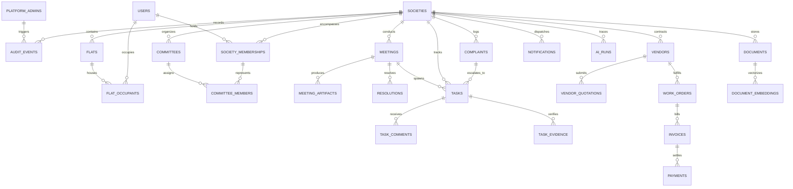

# SocietyFix AI — Relational Data Model & Database Architecture

> **Document ID:** DATA-001  
> **Status:** Approved / Milestone M0 Baseline  
> **Engine:** PostgreSQL 16+ (Google Cloud SQL) with `pgvector` & `uuid-ossp`  
> **Schema Philosophy:** Strict Multi-Tenant Relational Schema with Tenant-Scoped Foreign Keys, Minor-Unit Financials, and Cryptographic Auditability

---

## 1. Data Model Principles & Architectural Constraints

1. **Mandatory Tenant Key (`society_id`):** Every domain entity (flats, members, meetings, tasks, resolutions, invoices) contains a foreign key to `societies(id)`. Cross-tenant queries are structurally prevented.
2. **Exact Minor-Unit Currency (Paise):** All monetary amounts are stored as 64-bit integers (`BIGINT`) representing minor currency units (1 INR = 100 paise). Banned types: `FLOAT`, `DOUBLE PRECISION`, `REAL`.
3. **Draft vs. Authoritative Duality:** AI-extracted entities (proposed tasks, draft minutes, extracted invoice line items) are flagged with `is_ai_draft = true` and `verified_at IS NULL`. They become legally binding only when confirmed by an authorized committee member.
4. **Immutable Audit Trails:** The `audit_events` and `financial_transactions` tables are strictly append-only. Updates and deletes are prohibited by database rules or application-level read-only grants.
5. **Vector Search Grounding:** Text chunks from meeting minutes, bye-laws, circulars, and resolutions are stored alongside their dense vector embeddings (`vector(768)`) using `pgvector` with HNSW or IVFFlat indexes.

---

## 2. High-Level Entity-Relationship (ER) Diagram



---

## 3. Detailed Table Specifications & DDL Reference

### 3.1 Platform, Identity & Multi-Tenancy

```sql
-- Global Platform Administrators (Not bound to a single society)
CREATE TABLE platform_admins (
    id UUID PRIMARY KEY DEFAULT gen_random_uuid(),
    email VARCHAR(255) NOT NULL UNIQUE,
    full_name VARCHAR(255) NOT NULL,
    is_active BOOLEAN NOT NULL DEFAULT true,
    created_at TIMESTAMPTZ NOT NULL DEFAULT clock_timestamp(),
    updated_at TIMESTAMPTZ NOT NULL DEFAULT clock_timestamp()
);

-- Global User Directory (Synchronized from Firebase Auth)
CREATE TABLE users (
    id UUID PRIMARY KEY DEFAULT gen_random_uuid(),
    firebase_uid VARCHAR(128) NOT NULL UNIQUE,
    email VARCHAR(255) NOT NULL UNIQUE,
    phone_number VARCHAR(32),
    full_name VARCHAR(255) NOT NULL,
    avatar_url TEXT,
    preferred_language VARCHAR(10) NOT NULL DEFAULT 'en', -- en, hi, mr, etc.
    is_active BOOLEAN NOT NULL DEFAULT true,
    created_at TIMESTAMPTZ NOT NULL DEFAULT clock_timestamp(),
    updated_at TIMESTAMPTZ NOT NULL DEFAULT clock_timestamp()
);
CREATE INDEX idx_users_email ON users(email);
CREATE INDEX idx_users_firebase_uid ON users(firebase_uid);

-- Housing Societies (Tenants)
CREATE TABLE societies (
    id UUID PRIMARY KEY DEFAULT gen_random_uuid(),
    registration_number VARCHAR(100) NOT NULL UNIQUE,
    name VARCHAR(255) NOT NULL,
    legal_name VARCHAR(255) NOT NULL,
    society_type VARCHAR(50) NOT NULL DEFAULT 'CHS', -- CHS, RWA, AOA
    address_line1 TEXT NOT NULL,
    address_line2 TEXT,
    city VARCHAR(100) NOT NULL,
    state VARCHAR(100) NOT NULL,
    pincode VARCHAR(10) NOT NULL,
    established_year INT,
    total_wings INT NOT NULL DEFAULT 1,
    total_flats INT NOT NULL DEFAULT 0,
    currency_code VARCHAR(3) NOT NULL DEFAULT 'INR',
    settings JSONB NOT NULL DEFAULT '{}'::jsonb, -- Quorum %, late fee %, financial year start
    created_at TIMESTAMPTZ NOT NULL DEFAULT clock_timestamp(),
    updated_at TIMESTAMPTZ NOT NULL DEFAULT clock_timestamp()
);

-- Society Memberships & Access Grants
CREATE TYPE membership_status AS ENUM ('PENDING_APPROVAL', 'ACTIVE', 'SUSPENDED', 'REVOKED');

CREATE TABLE society_memberships (
    id UUID PRIMARY KEY DEFAULT gen_random_uuid(),
    society_id UUID NOT NULL REFERENCES societies(id) ON DELETE RESTRICT,
    user_id UUID NOT NULL REFERENCES users(id) ON DELETE RESTRICT,
    status membership_status NOT NULL DEFAULT 'PENDING_APPROVAL',
    roles TEXT[] NOT NULL DEFAULT ARRAY['RESIDENT'], 
    -- Roles: 'CHAIRMAN', 'HON_SECRETARY', 'TREASURER', 'COMMITTEE_MEMBER', 
    -- 'SUBCOMMITTEE_LEAD', 'RESIDENT_OWNER', 'RESIDENT_TENANT', 'STAFF', 'VENDOR'
    proof_document_url TEXT, -- Electricity bill, index-II, or lease agreement
    approved_by_user_id UUID REFERENCES users(id),
    approved_at TIMESTAMPTZ,
    notes TEXT,
    created_at TIMESTAMPTZ NOT NULL DEFAULT clock_timestamp(),
    updated_at TIMESTAMPTZ NOT NULL DEFAULT clock_timestamp(),
    CONSTRAINT uq_society_user UNIQUE (society_id, user_id)
);
CREATE INDEX idx_memberships_society_status ON society_memberships(society_id, status);
CREATE INDEX idx_memberships_user ON society_memberships(user_id);
```

### 3.2 Flats, Wings & Occupancy

```sql
CREATE TABLE wings (
    id UUID PRIMARY KEY DEFAULT gen_random_uuid(),
    society_id UUID NOT NULL REFERENCES societies(id) ON DELETE CASCADE,
    name VARCHAR(50) NOT NULL, -- "Wing A", "Tower 1"
    total_floors INT NOT NULL DEFAULT 1,
    created_at TIMESTAMPTZ NOT NULL DEFAULT clock_timestamp(),
    CONSTRAINT uq_wing_name UNIQUE (society_id, name)
);

CREATE TABLE flats (
    id UUID PRIMARY KEY DEFAULT gen_random_uuid(),
    society_id UUID NOT NULL REFERENCES societies(id) ON DELETE CASCADE,
    wing_id UUID NOT NULL REFERENCES wings(id) ON DELETE RESTRICT,
    flat_number VARCHAR(50) NOT NULL, -- "402", "B-1201"
    floor_number INT NOT NULL,
    carpet_area_sqft NUMERIC(8,2),
    built_up_area_sqft NUMERIC(8,2),
    intercom_extension VARCHAR(20),
    allocated_parking_slots TEXT[],
    created_at TIMESTAMPTZ NOT NULL DEFAULT clock_timestamp(),
    CONSTRAINT uq_flat_per_wing UNIQUE (society_id, wing_id, flat_number)
);

CREATE TYPE occupancy_type AS ENUM ('OWNER_RESIDING', 'TENANT_RESIDING', 'VACANT', 'COMMERCIAL');

CREATE TABLE flat_occupants (
    id UUID PRIMARY KEY DEFAULT gen_random_uuid(),
    society_id UUID NOT NULL REFERENCES societies(id) ON DELETE CASCADE,
    flat_id UUID NOT NULL REFERENCES flats(id) ON DELETE CASCADE,
    user_id UUID NOT NULL REFERENCES users(id) ON DELETE RESTRICT,
    occupancy_type occupancy_type NOT NULL DEFAULT 'OWNER_RESIDING',
    is_primary_contact BOOLEAN NOT NULL DEFAULT false,
    lease_start_date DATE,
    lease_end_date DATE,
    police_verification_done BOOLEAN DEFAULT false,
    created_at TIMESTAMPTZ NOT NULL DEFAULT clock_timestamp(),
    updated_at TIMESTAMPTZ NOT NULL DEFAULT clock_timestamp()
);
CREATE INDEX idx_flat_occupants_flat ON flat_occupants(society_id, flat_id);
```

### 3.3 Committees & Subcommittees

```sql
CREATE TYPE committee_type AS ENUM ('CORE_MANAGING_COMMITTEE', 'ISSUE_SUBCOMMITTEE');

CREATE TABLE committees (
    id UUID PRIMARY KEY DEFAULT gen_random_uuid(),
    society_id UUID NOT NULL REFERENCES societies(id) ON DELETE CASCADE,
    name VARCHAR(255) NOT NULL, -- "Managing Committee 2026-28" or "Solar Project Committee"
    type committee_type NOT NULL DEFAULT 'CORE_MANAGING_COMMITTEE',
    description TEXT,
    term_start_date DATE NOT NULL,
    term_end_date DATE,
    spending_limit_paise BIGINT NOT NULL DEFAULT 0, -- Delegated spending authority in paise
    is_active BOOLEAN NOT NULL DEFAULT true,
    created_at TIMESTAMPTZ NOT NULL DEFAULT clock_timestamp()
);

CREATE TABLE committee_members (
    id UUID PRIMARY KEY DEFAULT gen_random_uuid(),
    society_id UUID NOT NULL REFERENCES societies(id) ON DELETE CASCADE,
    committee_id UUID NOT NULL REFERENCES committees(id) ON DELETE CASCADE,
    membership_id UUID NOT NULL REFERENCES society_memberships(id) ON DELETE CASCADE,
    designation VARCHAR(100) NOT NULL, -- 'CHAIRMAN', 'HON_SECRETARY', 'TREASURER', 'LEAD', 'MEMBER'
    appointed_at DATE NOT NULL DEFAULT CURRENT_DATE,
    resigned_at DATE,
    is_active BOOLEAN NOT NULL DEFAULT true,
    CONSTRAINT uq_committee_member UNIQUE (committee_id, membership_id)
);
```

### 3.4 Meetings, Artifacts, Minutes & Resolutions

```sql
CREATE TYPE meeting_type AS ENUM ('MANAGING_COMMITTEE', 'AGM', 'EGM', 'SUBCOMMITTEE', 'INFORMAL');
CREATE TYPE meeting_status AS ENUM ('SCHEDULED', 'IN_PROGRESS', 'ADJOURNED', 'MINUTES_DRAFTED', 'MINUTES_APPROVED');

CREATE TABLE meetings (
    id UUID PRIMARY KEY DEFAULT gen_random_uuid(),
    society_id UUID NOT NULL REFERENCES societies(id) ON DELETE CASCADE,
    committee_id UUID REFERENCES committees(id) ON DELETE SET NULL,
    meeting_number VARCHAR(50), -- "MC/2026/04" or "AGM/2026"
    title VARCHAR(255) NOT NULL,
    meeting_type meeting_type NOT NULL DEFAULT 'MANAGING_COMMITTEE',
    scheduled_start TIMESTAMPTZ NOT NULL,
    scheduled_end TIMESTAMPTZ NOT NULL,
    actual_start TIMESTAMPTZ,
    actual_end TIMESTAMPTZ,
    location VARCHAR(255) NOT NULL DEFAULT 'Society Clubhouse / Hybrid',
    status meeting_status NOT NULL DEFAULT 'SCHEDULED',
    agenda_items JSONB NOT NULL DEFAULT '[]'::jsonb, -- Array of agenda items
    raw_meeting_notes TEXT, -- Human-entered rough notes or scratchpad
    official_minutes_markdown TEXT, -- Formal approved MOM
    quorum_present BOOLEAN NOT NULL DEFAULT false,
    attendees_count INT NOT NULL DEFAULT 0,
    created_by_user_id UUID NOT NULL REFERENCES users(id),
    approved_by_user_id UUID REFERENCES users(id),
    approved_at TIMESTAMPTZ,
    created_at TIMESTAMPTZ NOT NULL DEFAULT clock_timestamp(),
    updated_at TIMESTAMPTZ NOT NULL DEFAULT clock_timestamp()
);
CREATE INDEX idx_meetings_society_date ON meetings(society_id, scheduled_start DESC);

CREATE TABLE meeting_artifacts (
    id UUID PRIMARY KEY DEFAULT gen_random_uuid(),
    society_id UUID NOT NULL REFERENCES societies(id) ON DELETE CASCADE,
    meeting_id UUID NOT NULL REFERENCES meetings(id) ON DELETE CASCADE,
    artifact_type VARCHAR(50) NOT NULL, -- 'AUDIO_RECORDING', 'TRANSCRIPT', 'PHOTO_ATTENDANCE', 'PRESENTATION'
    file_path TEXT NOT NULL, -- GCS path: societies/{id}/meetings/{id}/...
    file_size_bytes BIGINT NOT NULL,
    mime_type VARCHAR(100) NOT NULL,
    uploaded_by_user_id UUID NOT NULL REFERENCES users(id),
    created_at TIMESTAMPTZ NOT NULL DEFAULT clock_timestamp()
);

CREATE TYPE resolution_status AS ENUM ('PROPOSED', 'PASSED_UNANIMOUSLY', 'PASSED_MAJORITY', 'REJECTED', 'DEFERRED');

CREATE TABLE resolutions (
    id UUID PRIMARY KEY DEFAULT gen_random_uuid(),
    society_id UUID NOT NULL REFERENCES societies(id) ON DELETE CASCADE,
    meeting_id UUID NOT NULL REFERENCES meetings(id) ON DELETE CASCADE,
    resolution_number VARCHAR(50) NOT NULL, -- "RES-2026-012"
    agenda_item_ref VARCHAR(50),
    title VARCHAR(255) NOT NULL,
    description TEXT NOT NULL,
    status resolution_status NOT NULL DEFAULT 'PROPOSED',
    proposed_by_user_id UUID NOT NULL REFERENCES users(id),
    seconded_by_user_id UUID REFERENCES users(id),
    votes_in_favor INT NOT NULL DEFAULT 0,
    votes_against INT NOT NULL DEFAULT 0,
    votes_abstained INT NOT NULL DEFAULT 0,
    is_statutory BOOLEAN NOT NULL DEFAULT false, -- Required to be filed with Registrar of CHS
    created_at TIMESTAMPTZ NOT NULL DEFAULT clock_timestamp(),
    CONSTRAINT uq_resolution_number UNIQUE (society_id, resolution_number)
);
CREATE INDEX idx_resolutions_society ON resolutions(society_id);
```

### 3.5 Tasks, Commitments, Dependencies & Evidence

```sql
CREATE TYPE task_priority AS ENUM ('LOW', 'MEDIUM', 'HIGH', 'CRITICAL_URGENT');
CREATE TYPE task_status AS ENUM ('PROPOSED_BY_AI', 'ASSIGNED', 'IN_PROGRESS', 'WAITING_FOR_EVIDENCE', 'COMPLETED', 'CANCELLED', 'OVERDUE');

CREATE TABLE tasks (
    id UUID PRIMARY KEY DEFAULT gen_random_uuid(),
    society_id UUID NOT NULL REFERENCES societies(id) ON DELETE CASCADE,
    meeting_id UUID REFERENCES meetings(id) ON DELETE SET NULL,
    resolution_id UUID REFERENCES resolutions(id) ON DELETE SET NULL,
    title VARCHAR(255) NOT NULL,
    description TEXT,
    priority task_priority NOT NULL DEFAULT 'MEDIUM',
    status task_status NOT NULL DEFAULT 'ASSIGNED',
    
    -- Assignee & Accountability
    assigned_to_user_id UUID REFERENCES users(id),
    assigned_to_committee_id UUID REFERENCES committees(id),
    created_by_user_id UUID NOT NULL REFERENCES users(id),
    
    -- Timelines & SLAs
    due_date DATE NOT NULL,
    completed_at TIMESTAMPTZ,
    
    -- AI Extraction Provenance
    is_ai_draft BOOLEAN NOT NULL DEFAULT false,
    ai_confidence_score NUMERIC(3,2), -- e.g. 0.95
    source_ai_run_id UUID,
    
    -- Budget Allocation (if applicable)
    budget_allocated_paise BIGINT DEFAULT 0,
    actual_spent_paise BIGINT DEFAULT 0,
    
    created_at TIMESTAMPTZ NOT NULL DEFAULT clock_timestamp(),
    updated_at TIMESTAMPTZ NOT NULL DEFAULT clock_timestamp()
);
CREATE INDEX idx_tasks_society_status ON tasks(society_id, status);
CREATE INDEX idx_tasks_due_date ON tasks(society_id, due_date) WHERE status NOT IN ('COMPLETED', 'CANCELLED');
CREATE INDEX idx_tasks_assignee ON tasks(society_id, assigned_to_user_id);

CREATE TABLE task_dependencies (
    parent_task_id UUID NOT NULL REFERENCES tasks(id) ON DELETE CASCADE,
    blocking_task_id UUID NOT NULL REFERENCES tasks(id) ON DELETE CASCADE,
    society_id UUID NOT NULL REFERENCES societies(id) ON DELETE CASCADE,
    PRIMARY KEY (parent_task_id, blocking_task_id)
);

CREATE TABLE task_comments (
    id UUID PRIMARY KEY DEFAULT gen_random_uuid(),
    society_id UUID NOT NULL REFERENCES societies(id) ON DELETE CASCADE,
    task_id UUID NOT NULL REFERENCES tasks(id) ON DELETE CASCADE,
    user_id UUID NOT NULL REFERENCES users(id) ON DELETE RESTRICT,
    comment_text TEXT NOT NULL,
    created_at TIMESTAMPTZ NOT NULL DEFAULT clock_timestamp()
);

CREATE TABLE task_evidence (
    id UUID PRIMARY KEY DEFAULT gen_random_uuid(),
    society_id UUID NOT NULL REFERENCES societies(id) ON DELETE CASCADE,
    task_id UUID NOT NULL REFERENCES tasks(id) ON DELETE CASCADE,
    uploaded_by_user_id UUID NOT NULL REFERENCES users(id),
    file_path TEXT NOT NULL,
    description TEXT,
    verified_by_user_id UUID REFERENCES users(id),
    verified_at TIMESTAMPTZ,
    created_at TIMESTAMPTZ NOT NULL DEFAULT clock_timestamp()
);
```

### 3.6 Vendors, Procurement & Financial Records

```sql
CREATE TABLE vendors (
    id UUID PRIMARY KEY DEFAULT gen_random_uuid(),
    society_id UUID NOT NULL REFERENCES societies(id) ON DELETE CASCADE,
    company_name VARCHAR(255) NOT NULL,
    contact_person VARCHAR(255),
    phone VARCHAR(32) NOT NULL,
    email VARCHAR(255),
    service_category VARCHAR(100) NOT NULL, -- 'LIFT_AMC', 'SECURITY', 'PLUMBING', 'GARDENING'
    gstin VARCHAR(20),
    pan VARCHAR(20),
    is_msme BOOLEAN DEFAULT false,
    bank_account_number VARCHAR(50),
    bank_ifsc VARCHAR(20),
    created_at TIMESTAMPTZ NOT NULL DEFAULT clock_timestamp()
);

CREATE TYPE work_order_status AS ENUM ('DRAFT', 'APPROVED_BY_COMMITTEE', 'ISSUED_TO_VENDOR', 'IN_EXECUTION', 'WORK_COMPLETED', 'PAYMENT_SETTLED', 'CANCELLED');

CREATE TABLE work_orders (
    id UUID PRIMARY KEY DEFAULT gen_random_uuid(),
    society_id UUID NOT NULL REFERENCES societies(id) ON DELETE CASCADE,
    vendor_id UUID NOT NULL REFERENCES vendors(id) ON DELETE RESTRICT,
    task_id UUID REFERENCES tasks(id) ON DELETE SET NULL,
    work_order_number VARCHAR(50) NOT NULL, -- "WO-2026-004"
    scope_of_work TEXT NOT NULL,
    agreed_amount_paise BIGINT NOT NULL, -- Exact paise
    approved_by_secretary_id UUID REFERENCES users(id),
    approved_by_treasurer_id UUID REFERENCES users(id),
    status work_order_status NOT NULL DEFAULT 'DRAFT',
    created_at TIMESTAMPTZ NOT NULL DEFAULT clock_timestamp(),
    CONSTRAINT uq_work_order UNIQUE (society_id, work_order_number)
);

CREATE TYPE invoice_status AS ENUM ('SUBMITTED', 'VERIFIED', 'APPROVED_FOR_PAYMENT', 'PAID', 'DISPUTED');

CREATE TABLE invoices (
    id UUID PRIMARY KEY DEFAULT gen_random_uuid(),
    society_id UUID NOT NULL REFERENCES societies(id) ON DELETE CASCADE,
    vendor_id UUID NOT NULL REFERENCES vendors(id) ON DELETE RESTRICT,
    work_order_id UUID REFERENCES work_orders(id) ON DELETE RESTRICT,
    invoice_number VARCHAR(100) NOT NULL,
    invoice_date DATE NOT NULL,
    subtotal_amount_paise BIGINT NOT NULL,
    gst_amount_paise BIGINT NOT NULL DEFAULT 0,
    tds_deducted_paise BIGINT NOT NULL DEFAULT 0,
    net_payable_paise BIGINT NOT NULL, -- subtotal + gst - tds
    document_file_path TEXT NOT NULL,
    status invoice_status NOT NULL DEFAULT 'SUBMITTED',
    verified_by_treasurer_id UUID REFERENCES users(id),
    verified_at TIMESTAMPTZ,
    created_at TIMESTAMPTZ NOT NULL DEFAULT clock_timestamp(),
    CONSTRAINT uq_vendor_invoice UNIQUE (society_id, vendor_id, invoice_number)
);
```

### 3.7 Vector Embeddings & Society Memory

```sql
CREATE EXTENSION IF NOT EXISTS vector;

CREATE TABLE documents (
    id UUID PRIMARY KEY DEFAULT gen_random_uuid(),
    society_id UUID NOT NULL REFERENCES societies(id) ON DELETE CASCADE,
    title VARCHAR(255) NOT NULL,
    category VARCHAR(50) NOT NULL, -- 'BYE_LAWS', 'AGM_MOM', 'CIRCULAR', 'AUDIT_REPORT'
    file_path TEXT NOT NULL,
    mime_type VARCHAR(100) NOT NULL,
    file_size_bytes BIGINT NOT NULL,
    uploaded_by_user_id UUID NOT NULL REFERENCES users(id),
    created_at TIMESTAMPTZ NOT NULL DEFAULT clock_timestamp()
);

CREATE TABLE document_embeddings (
    id UUID PRIMARY KEY DEFAULT gen_random_uuid(),
    society_id UUID NOT NULL REFERENCES societies(id) ON DELETE CASCADE,
    document_id UUID REFERENCES documents(id) ON DELETE CASCADE,
    meeting_id UUID REFERENCES meetings(id) ON DELETE CASCADE,
    chunk_index INT NOT NULL,
    chunk_content TEXT NOT NULL,
    metadata JSONB NOT NULL DEFAULT '{}'::jsonb, -- e.g., {"date": "2026-08-15", "type": "AGM"}
    embedding vector(768) NOT NULL, -- Standard dense embedding dimension (Gemma / Vertex AI text-embedding)
    created_at TIMESTAMPTZ NOT NULL DEFAULT clock_timestamp()
);
CREATE INDEX idx_doc_embeddings_society ON document_embeddings(society_id);
-- HNSW index for sub-10ms vector similarity lookup
CREATE INDEX idx_doc_embeddings_hnsw ON document_embeddings USING hnsw (embedding vector_cosine_ops) WITH (m = 16, ef_construction = 64);
```

### 3.8 AI Telemetry, Runs & Auditability

```sql
CREATE TABLE ai_runs (
    id UUID PRIMARY KEY DEFAULT gen_random_uuid(),
    society_id UUID REFERENCES societies(id) ON DELETE CASCADE,
    triggered_by_user_id UUID REFERENCES users(id),
    operation_type VARCHAR(50) NOT NULL, -- 'EXTRACT_MOM', 'PROPOSE_TASKS', 'SEARCH_MEMORY', 'TRANSCRIBE'
    model_name VARCHAR(100) NOT NULL, -- 'gemma-2-9b-it', 'gemini-2.5-flash'
    prompt_tokens INT NOT NULL DEFAULT 0,
    completion_tokens INT NOT NULL DEFAULT 0,
    latency_ms INT NOT NULL DEFAULT 0,
    status VARCHAR(20) NOT NULL DEFAULT 'SUCCESS', -- 'SUCCESS', 'FAILED', 'RATE_LIMITED'
    error_message TEXT,
    created_at TIMESTAMPTZ NOT NULL DEFAULT clock_timestamp()
);
CREATE INDEX idx_ai_runs_society ON ai_runs(society_id, created_at DESC);

CREATE TABLE audit_events (
    id UUID PRIMARY KEY DEFAULT gen_random_uuid(),
    society_id UUID REFERENCES societies(id) ON DELETE CASCADE,
    user_id UUID REFERENCES users(id),
    action VARCHAR(100) NOT NULL, -- 'AUTH.LOGIN', 'MEETING.CREATE', 'RESOLUTION.PASS', 'TASK.ASSIGN', 'INVOICE.PAY'
    resource_type VARCHAR(50) NOT NULL, -- 'MEETING', 'TASK', 'USER', 'INVOICE'
    resource_id UUID NOT NULL,
    changes JSONB, -- Diff: {"old": {...}, "new": {...}}
    ip_address INET,
    user_agent TEXT,
    created_at TIMESTAMPTZ NOT NULL DEFAULT clock_timestamp()
);
CREATE INDEX idx_audit_events_society ON audit_events(society_id, created_at DESC);
CREATE INDEX idx_audit_events_resource ON audit_events(resource_type, resource_id);

CREATE TABLE notifications (
    id UUID PRIMARY KEY DEFAULT gen_random_uuid(),
    society_id UUID NOT NULL REFERENCES societies(id) ON DELETE CASCADE,
    recipient_user_id UUID NOT NULL REFERENCES users(id) ON DELETE CASCADE,
    title VARCHAR(255) NOT NULL,
    body TEXT NOT NULL,
    link_url TEXT,
    channel VARCHAR(30) NOT NULL DEFAULT 'IN_APP', -- 'IN_APP', 'EMAIL', 'WHATSAPP'
    is_read BOOLEAN NOT NULL DEFAULT false,
    read_at TIMESTAMPTZ,
    created_at TIMESTAMPTZ NOT NULL DEFAULT clock_timestamp()
);
CREATE INDEX idx_notifications_recipient ON notifications(recipient_user_id, is_read, created_at DESC);
```

---

## 4. Data Governance, Privacy & Retention Policies

| Data Category | Retention Period | Deletion & Masking Strategy | Legal / Regulatory Basis |
| :--- | :--- | :--- | :--- |
| **Meeting Minutes & Resolutions** | Permanent (Minimum 20 Years) | Immutable storage; never deleted; encrypted at rest | MCS Act Bye-law #108 (Permanent society record) |
| **Financial Ledgers & Invoices** | 8 Years from financial year end | Sealed against modification after statutory audit | Income Tax Act (Section 44AA) & Companies/Coop Act |
| **Audio Recordings of Meetings** | 90 Days post approved MOM | Automatically purged from GCS after committee sign-off | DPDP Act 2023 (Storage limitation principle) |
| **Resident PII (Phone, Email)** | Duration of active residency + 30 days | Anonymized on flat handover (`user_id` de-linked) | DPDP Act 2023 (Right to erasure) |
| **Visitor & Delivery Logs** | 90 Days rolling window | Automated partition drop via Cloud Scheduler cron | DPDP Act 2023 (Data minimization for security logs) |
| **Audit Logs** | 7 Years | Append-only; exportable to WORM (Write Once Read Many) | Corporate & Cooperative Society Governance |
