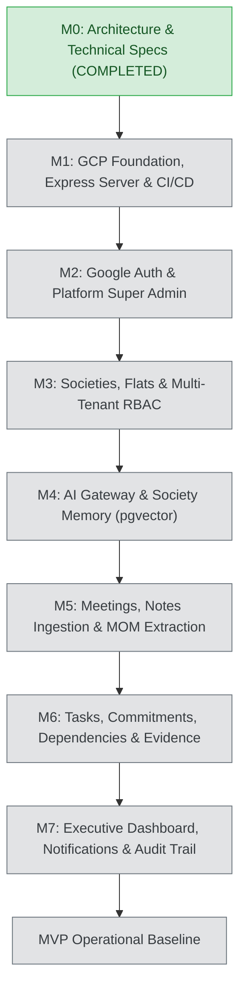
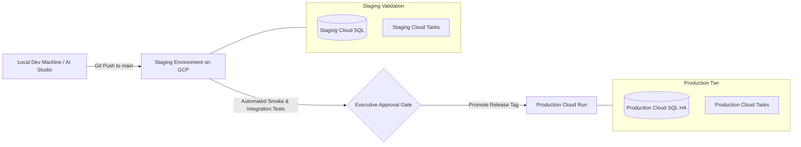

# SocietyFix AI — Implementation Roadmap & Execution Plan

> **Document ID:** ROADMAP-001  
> **Status:** Approved / Milestone M0 Baseline  
> **Execution Strategy:** Sequential Milestones with Strict Test Gates, Zero-Downtime Schema Evolutions, and Continuous Cloud Verification

---

## 1. Master Execution Schedule (Milestones M1 to M7)

---

## 2. Milestone Work Breakdown & Test Gates

### Milestone M1 — Google Cloud Foundation, Express Server & CI/CD
- **Dependencies:** M0 approval.
- **Key Tasks:**
  1. Create `server.ts` full-stack entry point mounting Express API routes alongside Vite middlewares in dev and static bundle in prod.
  2. Implement healthcheck endpoint `GET /api/health` returning commit SHA and database connectivity status.
  3. Set up multi-stage `Dockerfile` with non-root security context.
  4. Initialize Drizzle ORM configuration (`drizzle.config.ts`) and create migration runner.
  5. Configure CI/CD pipeline via GitHub Actions / Cloud Build running linting, TypeScript compilation, and unit tests.
- **Test Gate:**
  - `npm run lint` and `npm run build` pass with zero errors.
  - Container image builds cleanly and runs locally and in Cloud Run staging.

### Milestone M2 — Google Sign-In & Platform Super Admin
- **Dependencies:** M1.
- **Key Tasks:**
  1. Set up Firebase Authentication on client (Google OAuth popup).
  2. Implement backend JWT verification middleware using Firebase Admin SDK.
  3. Create auto-provisioning pipeline for authenticated users in the `users` table.
  4. Implement platform Super Admin authorization guard and bootstrap script.
  5. Build Super Admin dashboard UI for viewing system health and society tenants.
- **Test Gate:**
  - User can complete Google OAuth sign-in and receive session token.
  - Unauthenticated requests to `/api/v1/*` are rejected with HTTP 401.
  - Non-admin users attempting to access `/api/v1/admin/*` receive HTTP 403.

### Milestone M3 — Societies, Membership & Multi-Tenant RBAC
- **Dependencies:** M2.
- **Key Tasks:**
  1. Implement society registration wizard with legal details (registration number, wings, flats).
  2. Build flat and wing configuration management.
  3. Create resident join request workflow with document attachment (lease/index-II).
  4. Implement Secretary/Chairman approval, rejection, and role assignment interface.
  5. Implement `tenantContextMiddleware` and `requireCapability` RBAC guards.
- **Test Gate:**
  - Pending members are quarantined from society data until approved.
  - Automated tests confirm zero cross-tenant access between Society A and Society B.

### Milestone M4 — Provider-Neutral AI Gateway & Society Memory
- **Dependencies:** M3.
- **Key Tasks:**
  1. Implement `AIGatewayPort` with Google Gemma / Gemini adapter via `@google/genai`.
  2. Enable `pgvector` extension in PostgreSQL and create `document_embeddings` table.
  3. Implement text chunking and embedding pipeline for bye-laws and circulars.
  4. Build semantic search endpoint `POST /api/v1/societies/:id/memory/ask` with citation grounding.
  5. Implement token usage metering and latency logging in `ai_runs`.
- **Test Gate:**
  - AI responses to society questions include verifiable citations to indexed chunks.
  - Hallucinated queries without matching context return a calibrated "No verified society record found" response.

### Milestone M5 — Meeting Capture, Minutes & Resolution Extraction
- **Dependencies:** M4.
- **Key Tasks:**
  1. Build meeting scheduling interface with agenda items and quorum tracking.
  2. Create rough notes scratchpad and audio file upload pipeline to Google Cloud Storage.
  3. Implement AI extraction pipeline returning typed `ExtractedMeetingMinutesSchema` via Zod.
  4. Create statutory resolution creation and committee voting interface.
  5. Secretary review, edit, and formal approval workflow for MOM.
- **Test Gate:**
  - Meeting notes convert to structured MOM and draft tasks within 60 seconds.
  - Approved minutes are marked immutable and indexed into Society Memory.

### Milestone M6 — Task & Commitment Management
- **Dependencies:** M5.
- **Key Tasks:**
  1. Build Kanban board and table view for society tasks.
  2. Implement task creation from approved meeting action items.
  3. Support task dependencies (blocking tasks) and SLA timers.
  4. Build evidence submission interface (photo/document upload to GCS).
  5. Implement verification and approval workflow before tasks can be closed.
- **Test Gate:**
  - Task state machine rejects completion without approved evidence.
  - Overdue tasks trigger automated escalation notifications.

### Milestone M7 — Executive Dashboard, Notifications & Audit Trail
- **Dependencies:** M6.
- **Key Tasks:**
  1. Build role-tailored dashboard views for Chairman, Secretary, Treasurer, and Residents.
  2. Implement in-app notification center and asynchronous alert dispatch via Cloud Tasks.
  3. Implement tamper-evident audit log viewer for committee executives.
  4. Conduct end-to-end user acceptance testing with realistic housing society scenarios.
  5. Document operational deployment runbook and disaster recovery procedures.
- **Test Gate:**
  - Complete end-to-end lifecycle runs without errors: Meeting Notes -> Minutes -> Tasks -> Evidence -> Completion -> Memory Search.
  - Security audit confirms zero vulnerabilities on OWASP Top 10 checklist.

---

## 3. Environment Promotion & Release Strategy

1. **Development:** Local testing with Vite HMR, Express server, and development Cloud SQL database or local Docker PostgreSQL instance.
2. **Staging:** Automatic deployment on merge to `main`. Runs full end-to-end integration test suite with synthetic multi-tenant datasets.
3. **Production:** Manual promotion via semantic release tag (`v1.0.0`). Blue/green traffic migration on Cloud Run with automated rollback if error rates exceed 0.5%.
