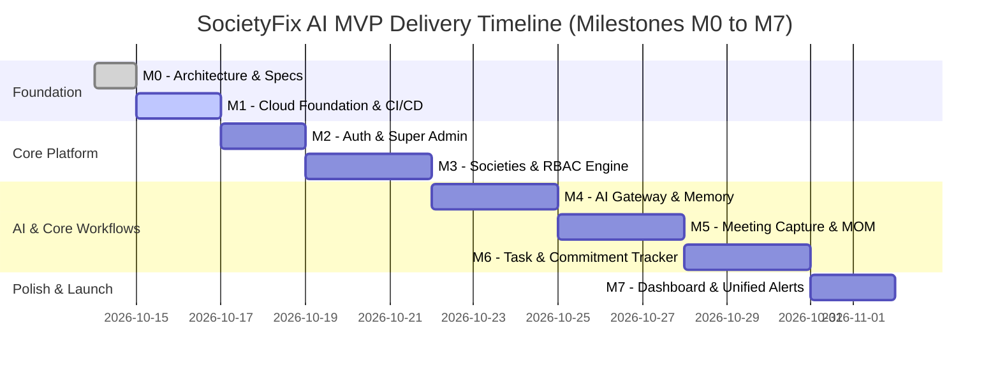

# SocietyFix AI — MVP Scope & Milestone Phasing (M0 to M7)

> **Document ID:** PLAN-001  
> **Status:** Approved / Milestone M0 Baseline  
> **MVP Objective:** Deliver an end-to-end, testable operating loop:  
> *"Meeting Notes Ingested -> Structured Minutes & Resolutions Generated -> Action Items Extracted & Assigned -> Commitments Tracked to Completion with Evidence -> Searchable in Society Memory."*

---

## 1. MVP Milestone Roadmap Overview

---

## 2. Detailed Milestone Specifications: Entry & Exit Criteria

### Milestone M0: Product Specification, Architecture and Technical Design
- **Objective:** Establish the comprehensive software architecture, data model, RBAC matrix, AI gateway design, and milestone plan before touching application code.
- **Entry Criteria:** Empty or placeholder repository; initial business brief received.
- **Exit Criteria:**
  - All 10 architectural deliverables created and cross-verified.
  - Zero application code or infrastructure modified during M0.
  - Open-source evaluation completed with clear reuse decisions.
- **Verification:** Verification of document completeness and cross-document consistency.

### Milestone M1: Google Cloud Foundation, CI/CD & Repository Skeleton
- **Objective:** Establish Google Cloud infrastructure as code, containerized full-stack runtime, database connectivity, and CI/CD pipeline.
- **Entry Criteria:** Approved M0 documentation.
- **Deliverables:**
  - `server.ts` entry point mounting Express API with Vite in dev and static serving in prod.
  - Dockerfile multi-stage container build targeting Cloud Run.
  - Drizzle ORM configuration and Cloud SQL connection setup.
  - GitHub Actions / Cloud Build workflow running type-checks, lints, and unit tests.
- **Exit Criteria:**
  - Application builds and runs cleanly on port 3000 locally and on Cloud Run.
  - Database migrations execute automatically against local or Cloud SQL PostgreSQL.
- **Verification:** `npm run build`, `npm run lint`, and healthcheck endpoint `GET /api/health` returns `200 OK`.

### Milestone M2: Google Sign-in & Platform Super Admin
- **Objective:** Implement Firebase Authentication with Google Sign-in, user synchronization, session management, and secure Super Admin bootstrap.
- **Entry Criteria:** M1 exit criteria fulfilled.
- **Deliverables:**
  - Client-side Google Sign-in component and AuthContext.
  - Server-side Firebase ID token verification middleware.
  - User synchronization pipeline into the `users` table.
  - Super Admin bootstrap script and initial administration dashboard.
- **Exit Criteria:**
  - Users can authenticate via Google OAuth popup.
  - Super Admin can log in and view platform-wide tenant listing.
  - Unauthenticated requests to protected endpoints return `401 Unauthorized`.
- **Verification:** Automated auth flow tests; validation that client cannot spoof `is_admin` or user ID.

### Milestone M3: Societies, Membership Management & RBAC Engine
- **Objective:** Multi-tenant society onboarding, flat hierarchy configuration, membership application lifecycle, and capability-based authorization.
- **Entry Criteria:** M2 exit criteria fulfilled.
- **Deliverables:**
  - Society creation wizard (Super Admin & initial onboarding).
  - Wing and flat configuration editor.
  - Resident join request flow with document upload (proof of ownership/tenancy).
  - Secretary/Chairman approval/rejection interface.
  - RBAC permission guard middleware implementing the capability matrix.
- **Exit Criteria:**
  - Pending members are quarantined and blocked from private records.
  - Chairman and Secretary can approve/reject membership requests.
  - Cross-tenant requests are intercepted and rejected with `403 Forbidden`.
- **Verification:** Multi-tenant integration tests verifying zero cross-tenant leakage.

### Milestone M4: Provider-Neutral AI Gateway & Society Memory
- **Objective:** Pluggable AI gateway implementation, Gemma/Gemini adapter, pgvector embeddings, and grounded semantic retrieval.
- **Entry Criteria:** M3 exit criteria fulfilled.
- **Deliverables:**
  - `AIGatewayPort` with `GemmaAdapter` and test mock adapter.
  - Document chunking and embedding pipeline using `pgvector`.
  - Semantic query engine with cosine similarity ranking and metadata filtering.
  - Token quota metering and latency telemetry in `ai_runs`.
- **Exit Criteria:**
  - Natural language questions retrieve relevant society document chunks with citations.
  - Gateway rejects hallucinated answers with confidence below threshold.
- **Verification:** Golden retrieval evaluation suite with synthetic test questions.

### Milestone M5: Meeting Capture, Minutes & Resolution Extraction
- **Objective:** Meeting scheduling, agenda management, rough notes/audio ingestion, automatic MOM generation, and resolution recording.
- **Entry Criteria:** M4 exit criteria fulfilled.
- **Deliverables:**
  - Meeting scheduling UI with quorum tracking.
  - Notes ingestion scratchpad and audio file upload to Cloud Storage.
  - AI extraction pipeline generating structured MOM (Summary, Discussions, Decisions, Open Questions).
  - Statutory resolution management and committee voting workflow.
  - Secretary review, edit, and formal approval interface.
- **Exit Criteria:**
  - Raw meeting notes convert into structured MOM and draft tasks in < 60 seconds.
  - Approved minutes become immutable and are indexed into Society Memory.
- **Verification:** End-to-end meeting lifecycle tests from agenda to approved MOM.

### Milestone M6: Task & Commitment Management
- **Objective:** Action item assignment, dependency tracking, evidence submission, and escalation ladders.
- **Entry Criteria:** M5 exit criteria fulfilled.
- **Deliverables:**
  - Interactive Kanban and list view for society tasks.
  - Task assignment to committee members, estate managers, or vendors with due dates.
  - Task dependency graph (blocking tasks).
  - Evidence upload interface (photos/receipts) with verification workflow.
  - Automated SLA tracking and overdue escalation triggers.
- **Exit Criteria:**
  - Tasks can be transitioned through their lifecycle: Proposed -> Assigned -> In Progress -> Waiting Evidence -> Verified & Completed.
  - Evidence must be approved before a task can be marked Completed.
- **Verification:** Task state-machine validation tests.

### Milestone M7: Executive Dashboard, Notifications & Audit Trail (MVP Complete)
- **Objective:** Comprehensive role-tailored dashboards (Secretary, Treasurer, Resident), multi-channel notification dispatch, and tamper-evident audit logging.
- **Entry Criteria:** M6 exit criteria fulfilled.
- **Deliverables:**
  - Role-specific dashboard widgets (Overdue tasks, upcoming meetings, open resolutions).
  - In-app notification center and email digest dispatch via Cloud Tasks.
  - Filterable audit trail viewer for Chairman and Secretary.
  - MVP end-to-end smoke test suite and deployment runbook.
- **Exit Criteria:**
  - Complete "Meeting -> MOM -> Task -> Completion -> Memory" loop functions seamlessly in a staging environment.
  - All test suites pass with zero regressions.
- **Verification:** End-to-end user acceptance testing with representative housing society data.

---

## 3. Explicitly Deferred Capabilities (Post-MVP Phasing)

The following domains are explicitly out-of-scope for the MVP (M0–M7) to maintain velocity, testability, and architectural discipline:

| Deferred Domain | Description & Rationale | Target Phase |
| :--- | :--- | :--- |
| **Domain 7: Voice Complaints** | Multilingual voice intake & automated technician dispatch. Requires localized speech-to-text calibration and resident mobile optimization. | **Phase 2 (M8)** |
| **Domain 8: Assets & Preventive AMC** | Equipment QR tags, maintenance schedules for lifts/generators. Better introduced once task accountability is proven. | **Phase 2 (M9)** |
| **Domain 9: Vendor Quotations & RFQ** | Comparative quote parsing and contract management. Built on top of task and meeting workflows. | **Phase 2 (M10)** |
| **Domain 10: Billing & Accounting** | Full maintenance ledger, UPI payment gateways, GST/TDS calculations. Requires banking and payment gateway integrations. | **Phase 2 (M11)** |
| **Domain 11: Compliance Calendar** | Statutory filing deadlines (MCS Act, RERA). Relies on document and meeting repository maturity. | **Phase 2 (M12)** |
| **Domain 12: Gate & Visitor Management** | Real-time guard gatekeeper, OTP passes, maid biometrics. Competes with dedicated hardware gate apps; defer until core secretary features dominate. | **Phase 3 (M13)** |
| **Domain 13: Amenities & Event Booking** | Clubhouse/court slot booking and festival contributions. Non-critical community convenience. | **Phase 3 (M14)** |
| **Domain 14: Utilities & Sustainability** | Water tanker telemetry, solar panel monitoring, waste segregation logs. Relies on IoT sensor integrations. | **Phase 3 (M15)** |

---

## 4. MVP Risk Analysis & Mitigation Matrix

| Milestone | Critical Risk | Impact | Preventative Mitigation |
| :--- | :--- | :--- | :--- |
| **M1** | Cloud Run / Cloud SQL private connectivity latency or VPC peering complexity. | Delay in infrastructure deployment | Use Cloud SQL Node.js Connector with IAM auth or Cloud SQL Auth Proxy sidecar. |
| **M2** | Inability of users to sign in due to Firebase OAuth domain restrictions. | Auth blocked on custom domains | Add Cloud Run default and custom domains to Firebase Authorized Domains list. |
| **M3** | Accidental data leakage between societies in early development. | Critical privacy failure | Implement automated multi-tenant test suites that execute every endpoint against secondary tenant IDs. |
| **M4** | AI model hallucinations or missing citations in society question answering. | Loss of user trust in AI secretary | Implement strict prompt engineering with citation verification and minimum cosine similarity thresholds. |
| **M5** | Incomplete task extraction from rambling or disorganized meeting notes. | Tasks forgotten | Combine structured schema extraction with a secondary "verification pass" prompt to check completeness. |
| **M6** | Users bypass evidence submission to mark tasks completed. | Compromised accountability | Enforce backend check: `task.status = 'COMPLETED'` requires `verified_evidence_id IS NOT NULL`. |
| **M7** | Notification flooding leading to resident alert fatigue. | Users mute or ignore notifications | Default to daily batched digests with immediate alerts reserved solely for high-priority emergency tasks. |
