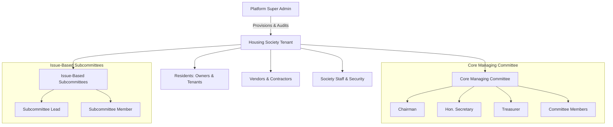
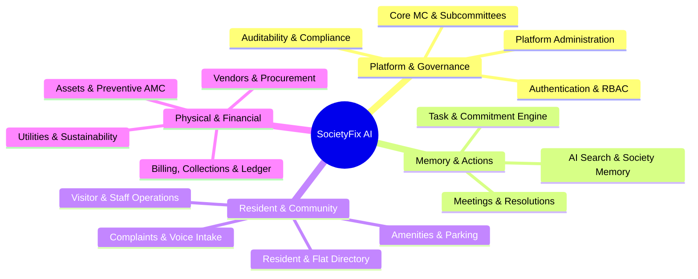

# SocietyFix AI — Product Specification

> **Document ID:** SPEC-001  
> **Status:** Approved / Milestone M0 Baseline  
> **Target Audience:** Engineering, Product, Security, Committee Stakeholders  
> **Core Promise:** *"Every discussion becomes an action. Every action gets tracked. Nothing gets forgotten."*

---

## 1. Executive Summary & Problem Space

Residential housing societies (Cooperative Housing Societies - CHS, Resident Welfare Associations - RWA, and Apartment Owners Associations - AOA) in India house over 60 million urban residents across Mumbai, Bengaluru, Pune, Delhi-NCR, Hyderabad, and Chennai. Despite managing annual maintenance budgets ranging from ₹20 Lakhs to over ₹10 Crores, their day-to-day operations suffer from severe operational friction:

1. **Lost Institutional Memory:** Discussions on WhatsApp groups and informal committee huddles evaporate. Decisions agreed upon during Annual General Meetings (AGM) or Managing Committee (MC) meetings get lost in paper registers or unstructured PDF circulars.
2. **Accountability Vacuum:** "Who was assigned to inspect the lift sensor?" "When does the diesel generator AMC expire?" Tasks are assigned verbally or in ephemeral chat threads with zero follow-through, leading to resident resentment and vendor delays.
3. **High Committee Burnout:** Office bearers (Chairman, Hon. Secretary, Treasurer) are unpaid resident volunteers who spend 10–20 hours a week chasing vendors, answering repetitive resident queries, following up on maintenance dues, and drafting minutes.
4. **Multilingual Barrier:** Maintenance staff, security guards, and diverse residents communicate across English, Hindi, Marathi, Kannada, Tamil, etc., creating communication chasms in complaint logging and resolution.
5. **Lack of Tenant Isolation & Governance:** Ad-hoc spreadsheet tracking exposes resident PII, lacks audit trails, and violates the Digital Personal Data Protection Act (DPDP Act 2023).

**SocietyFix AI** is designed as an AI-powered operating platform and "autonomous executive secretary" for Indian housing societies. It captures meetings and informal discussions, converts them into tracked action items, orchestrates committee workflows, empowers residents with voice-first complaint logging, and provides intelligent, grounded society memory without compromising security or regulatory governance.

---

## 2. Product Personas & User Ecosystem

### 2.1 Persona Directory

| Persona | Real-world Profile | Primary Pain Points | Key Objectives in SocietyFix |
| :--- | :--- | :--- | :--- |
| **Platform Super Admin** | Cloud platform site reliability engineer or central operator | Cross-tenant security, tenant onboarding, infrastructure health, billing across societies | Onboard societies, manage global quotas, oversee AI model health, audit system logs |
| **Hon. Secretary** | Elected resident executive; manages legal compliance, notices, meetings, vendor contracts | Spends entire weekends drafting Minutes of Meetings (MOM), fielding WhatsApp messages, tracking AMC expiries | Record/upload meeting discussions, auto-generate structured MOM, auto-extract tasks, issue notices |
| **Hon. Treasurer** | Chartered accountant or finance-savvy resident; manages society bank accounts, billing, expenses | Chasing maintenance defaulters, reconciliations, vendor invoice verification, audit preparation | Track billing ledger, approve work order disbursements, verify invoice compliance, audit-ready reports |
| **Chairman** | Senior community leader; presides over meetings, mediates disputes, signs contracts | Meeting disorder, lack of agenda adherence, dispute escalation, legal liabilities | Set clear agendas, oversee resolution voting, track macro-level society health and KPIs |
| **Subcommittee Lead** | Passionate resident running a temporary project (e.g., Solar Installation, Water Tank Renovation) | Disconnect from MC budget approvals, no centralized place to evaluate vendor quotes | Manage project milestone tasks, compare vendor bids, present recommendations to MC |
| **Resident Owner** | Apartment owner living on-premise or absentee landlord | Lack of transparency into maintenance spends, forgotten complaints, cumbersome payment methods | Log issues (voice/text), pay maintenance, track resolution progress, search past society decisions |
| **Tenant Resident** | Resident leasing a flat from an owner | Denied access to basic circulars, unclear amenity guidelines, friction with landlord approvals | Raise flat/common amenity tickets, book clubhouse/parking, receive society notices |
| **Society Manager / Admin** | Full-time on-site salaried administrative executive | Drowning in paperwork, manual register entries, coordinating electricians/plumbers | Daily task board, vendor coordination, visitor oversight, staff attendance |
| **Vendor / Contractor** | External service provider (Lift AMC, Pest Control, Security Agency) | Unclear job requirements, payment delays, disputed work completion claims | Receive work orders, upload completion photos/invoices, check payment status |
| **Maintenance Staff** | Electrician, plumber, security supervisor with varying tech literacy | Struggles with complex English UI, miscommunicated job locations | Simple mobile UI, voice-based updates, localized Indian language audio prompts |

---

## 3. Product Scope Across 16 Major Domains

### Domain 1: Platform Administration and Society Onboarding
- **Users:** Platform Super Admin, System Support.
- **Workflows:** Multi-tenant provisioning; automated society schema/storage isolation; custom society domain/subdomain mapping; subscription plan assignment; feature flags; global system health and token usage telemetry.
- **Data Ownership:** System Platform.
- **Dependencies:** Google Cloud Project, Cloud SQL, Firebase Auth.
- **Lifecycle:** **MVP Core (M1–M3)**.

### Domain 2: Authentication, Memberships, Roles and Permissions
- **Users:** All Personas.
- **Workflows:** Google Sign-in authentication; multi-society profile switching; join request submission with flat ownership/tenant proof; committee verification and role assignment; suspension and offboarding; privilege escalation defenses.
- **Data Ownership:** User Profile (Global), Society Membership (Tenant Scoped).
- **Dependencies:** Firebase Auth, PostgreSQL tenant tables.
- **Lifecycle:** **MVP Core (M2–M3)**.

### Domain 3: Core Managing Committee and Issue-Based Subcommittees
- **Users:** Chairman, Secretary, Treasurer, Committee Members, Subcommittee Leads.
- **Workflows:** Committee term configuration (e.g., 2026–2028 tenure); role appointment; creation of issue-based subcommittees (e.g., "EV Charging Infrastructure", "Terrace Waterproofing"); delegation of task domains and advisory spending budgets.
- **Data Ownership:** Society Tenant.
- **Dependencies:** Domain 2 (RBAC).
- **Lifecycle:** **MVP Core (M3)**.

### Domain 4: Meetings, Minutes, Resolutions, Decisions and Action Items
- **Users:** Managing Committee, Subcommittee Members, General Body (AGM/EGM).
- **Workflows:** Agenda drafting; hybrid/physical meeting scheduling with quorum tracking; audio recording or rough notes ingestion; AI-assisted transcription and speaker diarization; automatic structured MOM extraction (Decisions vs Discussions vs Open Questions); formal resolution recording with statutory voting (Passed/Rejected/Deferred).
- **Data Ownership:** Society Tenant.
- **Dependencies:** Domain 2, Domain 3, Domain 15 (AI Gateway).
- **Lifecycle:** **MVP Core (M5)**.

### Domain 5: Task Management, Dependencies, Evidence and Escalations
- **Users:** Committee Members, Society Manager, Staff, Vendors.
- **Workflows:** Action items automatically extracted from meetings or manually logged; explicit assignment with due dates and priority; sub-task decomposition; blocking dependencies; photographic/documentary proof of completion; SLA timers and automated escalation ladders (Assignee -> Manager -> Secretary -> Chairman).
- **Data Ownership:** Society Tenant.
- **Dependencies:** Domain 4, Domain 16 (Notifications).
- **Lifecycle:** **MVP Core (M6)**.

### Domain 6: Resident, Owner, Tenant, Flat and Occupancy Management
- **Users:** Society Admin, Residents, Owners.
- **Workflows:** Wing and flat hierarchy setup (Tower A -> Floor 4 -> Flat 402); flat ownership history; tenant lease period tracking; emergency contact directory; vehicle registration tagging; vehicle parking slot association.
- **Data Ownership:** Society Tenant.
- **Dependencies:** Domain 2 (RBAC).
- **Lifecycle:** **MVP Core (M3)**.

### Domain 7: Complaints and Multilingual Voice Intake
- **Users:** Residents (Owners/Tenants), Society Manager, Maintenance Staff.
- **Workflows:** Resident logs complaint via text or 30-second native voice note (Hindi, Marathi, English); AI transcribes, detects emotion/urgency, categorizes (Plumbing, Electrical, Noise, Security), and assigns to the right staff member; ticket resolution lifecycle with before/after photos.
- **Data Ownership:** Society Tenant.
- **Dependencies:** Domain 5 (Tasks), Domain 15 (AI Audio Processing).
- **Lifecycle:** **Post-MVP (Phase 2 / M8)**.

### Domain 8: Assets and Preventive Maintenance
- **Users:** Society Manager, Treasurer, Vendors.
- **Workflows:** Society asset registry (Lifts, Diesel Generators, Water Pumps, Fire Extinguishers, CCTV, Solar Panels); warranty and AMC contract tracking; preventive maintenance schedule generation; QR code asset tagging for physical inspection audits.
- **Data Ownership:** Society Tenant.
- **Dependencies:** Domain 5 (Tasks), Domain 9 (Vendors).
- **Lifecycle:** **Post-MVP (Phase 2 / M9)**.

### Domain 9: Vendors, Quotations, Procurement and Work Orders
- **Users:** Secretary, Treasurer, Subcommittee Leads, Vendors.
- **Workflows:** Vendor database (GSTIN, MSME status, contact); RFQ issuance; vendor bid upload; AI comparative quotation matrix (extracting line items, warranties, payment terms); committee review; formal Work Order generation; milestone sign-off.
- **Data Ownership:** Society Tenant.
- **Dependencies:** Domain 3 (Subcommittees), Domain 10 (Finance), Domain 15 (AI Extraction).
- **Lifecycle:** **Post-MVP (Phase 2 / M10)**.

### Domain 10: Maintenance Billing, Collections, Expenses and Invoices
- **Users:** Treasurer, Society Accountant, Residents.
- **Workflows:** Maintenance bill generation (sq. ft. rate + sinking fund + repair fund + parking charges + water meter); automated invoice distribution; payment gateway integration (UPI, Netbanking, NEFT reconciliation); late fee calculation; vendor expense recording with TDS and GST accounting; financial audit export.
- **Data Ownership:** Society Tenant.
- **Dependencies:** Domain 6 (Flats), Domain 9 (Vendors).
- **Lifecycle:** **Post-MVP (Phase 2 / M11)**.

### Domain 11: Documents, Notices and Compliance Calendars
- **Users:** Secretary, Chairman, Residents.
- **Workflows:** Repository of bye-laws, share certificates, conveyance deeds, structural audit reports; digital notice board with mandatory read receipts; statutory compliance calendar (Annual Audit deadline, Form 1 filing under MCS Act, fire safety inspection).
- **Data Ownership:** Society Tenant.
- **Dependencies:** Google Cloud Storage, Domain 2 (RBAC).
- **Lifecycle:** **Post-MVP (Phase 2 / M12)**.

### Domain 12: Visitor, Delivery, Contractor and Staff Operations
- **Users:** Security Guards, Residents, Staff.
- **Workflows:** Guard gatekeeper terminal; resident visitor pre-approval; delivery pass-code verification; daily domestic help / maid check-in with biometric or PIN; overstay alerts.
- **Data Ownership:** Society Tenant.
- **Dependencies:** Domain 6 (Flats).
- **Lifecycle:** **Post-MVP (Phase 3 / M13)**.

### Domain 13: Amenities, Parking, Bookings and Community Events
- **Users:** Residents, Committee.
- **Workflows:** Clubhouse, swimming pool, tennis court slot booking with slot quotas and deposit tracking; visitor parking management; festival and community event management with contribution pooling.
- **Data Ownership:** Society Tenant.
- **Dependencies:** Domain 6 (Flats), Domain 10 (Payments).
- **Lifecycle:** **Post-MVP (Phase 3 / M14)**.

### Domain 14: Utilities and Sustainability
- **Users:** Committee, Estate Manager.
- **Workflows:** Tanker water tracking (liters delivered, TDS, water quality); electricity meter logs for common areas; solar generation telemetry; waste segregation and composting audits.
- **Data Ownership:** Society Tenant.
- **Dependencies:** Domain 8 (Assets).
- **Lifecycle:** **Post-MVP (Phase 3 / M15)**.

### Domain 15: AI-Powered Search, Summaries, Recommendations and Briefings
- **Users:** Committee, Residents, Super Admin.
- **Workflows:** "Society Memory" natural language question-answering ("What did we decide about dog walking in the 2024 AGM?"); daily/weekly executive briefing for Secretary and Treasurer; automated drafting of meeting agendas; intelligent duplicate task/complaint detection.
- **Data Ownership:** Society Tenant (Derived & Indexed).
- **Dependencies:** PostgreSQL `pgvector`, Provider-Neutral AI Gateway, Gemma / Gemini models.
- **Lifecycle:** **MVP Core (M4, M5, M7)**.

### Domain 16: Notifications, Integrations, Reporting and Auditability
- **Users:** All Personas.
- **Workflows:** Multi-channel alert dispatch (In-App notifications, Email, WhatsApp Business API push); comprehensive tamper-evident audit log for every privileged action; monthly executive performance dashboard; export to PDF/Excel for registrar inspection.
- **Data Ownership:** Society Tenant.
- **Dependencies:** Domain 1–15.
- **Lifecycle:** **MVP Core (M7)**.

---

## 4. Key Performance Indicators & Acceptance Benchmarks

| Metric Category | Target SLA / KPI | Verification Method |
| :--- | :--- | :--- |
| **Meeting Turnaround** | Rough meeting notes to structured MOM & draft tasks < 60 seconds | Automated pipeline benchmark |
| **Task Accountability** | Zero untracked commitments from formal meetings | Automated resolution-to-task reconciliation audit |
| **Search Accuracy** | Retrieval Precision@5 > 90% with direct citation to source document/meeting | Synthetic golden evaluation dataset |
| **Multi-tenant Security** | 0 cross-tenant data leaks across all API endpoints | Automated row-level isolation test suite |
| **Financial Integrity** | 100% exact currency reconciliation to 0 minor units (paise) | Strict integer arithmetic & automated double-entry verification |
| **AI Safety** | 0 autonomous authorizations (budget, rules, election, permissions) | Architectural barrier & permission enforcement |

---

## 5. Regulatory & Compliance Context (India)

SocietyFix AI is architected from Day 1 to comply with Indian state apartment ownership and cooperative acts:
- **Maharashtra Co-operative Societies (MCS) Act, 1960 & Model Bye-Laws 2014:** Strict rules regarding notice periods (14 days for AGM, 3 days for MC), quorum tracking, minutes drafting timeline (within 30 days of meeting), and maintenance billing breakdown.
- **Karnataka Apartment Ownership Act (KAOA) & Real Estate (Regulation and Development) Act (RERA):** Requirements for statutory records transfer, sinking fund ring-fencing, and structural audit disclosures.
- **Digital Personal Data Protection Act (DPDP), 2023:** Data minimization, consent-backed phone/email processing, right to erasure upon tenant move-out, and strict purpose limitation for visitor phone numbers.
