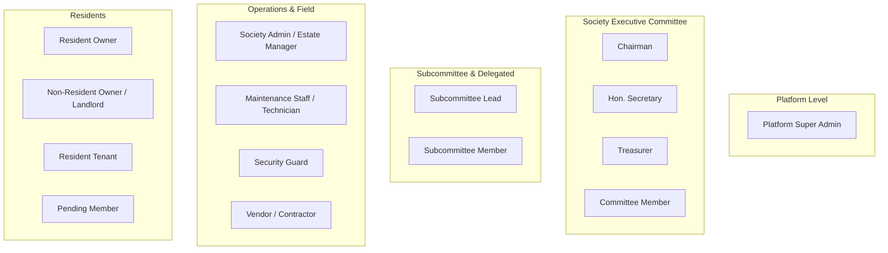

# SocietyFix AI — Role-Based Access Control (RBAC) & Tenant Security Matrix

> **Document ID:** SEC-001  
> **Status:** Approved / Milestone M0 Baseline  
> **Security Model:** Dual-Tiered Multi-Tenant RBAC with Capability-Based Permission Guard

---

## 1. Security Architecture & Threat Boundaries

### 1.1 Dual-Tier Security Architecture
The platform operates on two distinct privilege planes:
1. **Platform Plane (Global):** Governed by `platform_admins`. Manages global tenant creation, billing plans, infrastructure monitoring, and platform maintenance. Completely isolated from society-level records unless an explicit platform audit is invoked.
2. **Society Plane (Tenant):** Governed by `society_memberships`. All permissions are evaluated strictly within the context of an authenticated `(user_id, society_id)` tuple. A Chairman in "Palm Heights CHS" has zero privileges in "Green Acres CHS".

### 1.2 Non-Negotiable Security Invariants
- **Zero Self-Promotion:** No user can grant themselves administrative roles, upgrade their membership status, or assign permissions through client-controlled payload attributes.
- **Pending Member Quarantine:** Users with `membership_status = 'PENDING_APPROVAL'` have zero read/write access to private society data (meetings, tasks, resolutions, notices, resident directories). They can only view their own membership submission status.
- **Record-Level Tenant Assertion:** Every backend route validates that the URL `:societyId` matches the authenticated user's active tenant session AND that the target entity's `society_id` matches the tenant context.
- **Signed URL Authorization:** Direct storage links to GCS are never exposed. Storage signed URLs are only minted server-side after verifying that the user has the required capability to view that specific artifact category.

---

## 2. Society Roles & Personas



### Role Taxonomy

| Role Identifier | Real-World Role | Multi-Role Allowed? | Description & Scope |
| :--- | :--- | :--- | :--- |
| `SUPER_ADMIN` | Platform Operator | No (System-only) | Full cross-tenant infrastructure & society provisioning. |
| `CHAIRMAN` | Society President | Yes (with Owner) | High-level executive authority, meetings presider, dispute resolution. |
| `HON_SECRETARY` | Honorary Secretary | Yes (with Owner) | Operational leader, meeting minutes creator, task assigner, circular publisher. |
| `TREASURER` | Honorary Treasurer | Yes (with Owner) | Financial controller, budget approver, invoice verifier, payment reconciler. |
| `COMMITTEE_MEMBER`| Managing Committee | Yes (with Owner) | Voting on resolutions, reviewing executive tasks, subcommittee sponsorship. |
| `SUBCOMMITTEE_LEAD`| Taskforce Lead | Yes (Owner/Tenant)| Lead for specialized projects (e.g. Solar, Water Tank) with delegated tasks. |
| `SUBCOMMITTEE_MEMBER`| Taskforce Contributor| Yes (Owner/Tenant)| Contributor to specialized subcommittees. |
| `ESTATE_MANAGER` | Society Admin (Paid) | No | Day-to-day facility operations, initial task triage, vendor coordination. |
| `RESIDENT_OWNER` | Flat Owner Residing | Yes | Full voting rights in AGM, access to all public society records & amenities. |
| `NON_RESIDENT_OWNER`| Absentee Landlord | Yes | Access to flat maintenance dues, voting at AGM, society notices. |
| `RESIDENT_TENANT`| Flat Tenant | Yes | Access to flat tickets, amenity booking, circulars; no AGM voting. |
| `MAINTENANCE_STAFF`| Plumber/Electrician | No | View assigned work tickets, upload completion evidence; no committee records. |
| `VENDOR` | External Contractor | No | View assigned work orders, upload quotes & invoices; zero resident data access. |
| `PENDING_MEMBER` | Unverified Applicant| No | Quarantined; can only view and cancel own application. |

---

## 3. Comprehensive Capability & RBAC Matrix

Legend:
- **`CRUD`**: Full Create, Read, Update, Delete
- **`CRU`**: Create, Read, Update (No Delete)
- **`CR`**: Create, Read
- **`R`**: Read Only
- **`RO`**: Read Own Records Only (Scoped to User's flat or assignment)
- **`CUO`**: Create, Update Own Records Only
- **`VOTE`**: Statutory Voting Rights
- **`APP`**: Executive Sign-off / Approval Rights
- **`-`**: No Access (Forbidden, HTTP 403)

| Resource Domain | Specific Operation | `SUPER_ADMIN` | `CHAIRMAN` | `SECRETARY` | `TREASURER` | `CM` | `SUB_LEAD` | `ESTATE_MGR` | `OWNER` | `TENANT` | `STAFF` | `VENDOR` | `PENDING` |
| :--- | :--- | :---: | :---: | :---: | :---: | :---: | :---: | :---: | :---: | :---: | :---: | :---: | :---: |
| **Societies** | Provision New Society | `CRUD` | - | - | - | - | - | - | - | - | - | - | - |
| | Edit Society Settings / Bye-laws | `R` | `U` | `U` | `R` | `R` | - | `R` | `R` | `R` | - | - | - |
| **Memberships** | Approve/Reject Join Requests | `R` | `APP` | `APP` | `R` | `R` | - | `R` | - | - | - | - | - |
| | Suspend / Revoke Membership | `U` | `APP` | `APP` | - | - | - | - | - | - | - | - | - |
| | View Member Directory | `R` | `R` | `R` | `R` | `R` | `R` | `R` | `R` | `R` | - | - | - |
| **Flats & Wings** | Manage Flat Configurations | `R` | `CRUD` | `CRUD` | `R` | `R` | - | `U` | `RO` | - | - | - | - |
| | Update Occupant Mapping | `R` | `U` | `U` | `R` | `R` | - | `U` | `CUO` | `RO` | - | - | - |
| **Committees** | Create / Terminate Subcommittees | `R` | `APP` | `CRUD` | `R` | `R` | - | - | `R` | `R` | - | - | - |
| | Assign Committee Members | `R` | `APP` | `CRUD` | `R` | `R` | - | - | - | - | - | - | - |
| **Meetings** | Schedule MC / AGM Meeting | `R` | `APP` | `CRUD` | `R` | `R` | `CR` (Sub) | `R` | `R` (AGM) | `R` (AGM) | - | - | - |
| | Upload Audio / Raw Notes | `R` | `CR` | `CR` | `CR` | `CR` | `CR` (Sub) | `CR` | - | - | - | - | - |
| | Trigger AI MOM Extraction | `R` | `CR` | `CR` | `CR` | `CR` | `CR` (Sub) | `CR` | - | - | - | - | - |
| | Approve Official Minutes (MOM) | `R` | `APP` | `APP` | `R` | `R` | - | - | `R` (Pub) | `R` (Pub) | - | - | - |
| **Resolutions** | Propose Formal Resolution | `R` | `CR` | `CR` | `CR` | `CR` | `CR` (Sub) | - | `CR` (AGM) | - | - | - | - |
| | Vote on Resolution | - | `VOTE` | `VOTE` | `VOTE` | `VOTE` | - | - | `VOTE` (AGM)| - | - | - | - |
| | Ratify Resolution Status | `R` | `APP` | `APP` | `R` | `R` | - | - | `R` | `R` | - | - | - |
| **Tasks** | Create / Assign Tasks | `R` | `CRUD` | `CRUD` | `CRUD` | `CR` | `CR` (Sub) | `CRU` | `RO` | `RO` | - | - | - |
| | Update Status & Add Comments | `R` | `CRUD` | `CRUD` | `CRUD` | `CRU` | `CRU` | `CRU` | `CUO` | `CUO` | `CUO` | `CUO` | - |
| | Upload Completion Evidence | `R` | `CR` | `CR` | `CR` | `CR` | `CR` | `CR` | `CR` | `CR` | `CR` | `CR` | - |
| | Verify Evidence & Close Task | `R` | `APP` | `APP` | `APP` | `APP` | `APP` (Sub)| `APP` | - | - | - | - | - |
| **Complaints** | Log Ticket (Text/Voice) | `R` | `CR` | `CR` | `CR` | `CR` | `CR` | `CR` | `CUO` | `CUO` | - | - | - |
| | Triage & Assign Staff | `R` | `U` | `U` | `U` | `U` | - | `CRUD` | - | - | - | - | - |
| **Vendors** | Manage Vendor Database | `R` | `CRUD` | `CRUD` | `CRUD` | `R` | `R` | `CRU` | `R` | - | - | `RO` | - |
| | Issue Work Orders | `R` | `APP` | `CRU` | `APP` | `R` | - | `CR` | - | - | - | `RO` | - |
| **Finances** | Generate Maintenance Bills | `R` | `R` | `R` | `CRUD` | `R` | - | `R` | `RO` | `RO` | - | - | - |
| | Verify Vendor Invoices | `R` | `R` | `R` | `APP` | `R` | `R` (Sub) | `R` | - | - | - | `CUO` | - |
| | Approve Payments / Disbursements | `R` | `APP` | `APP` | `APP` | - | - | - | - | - | - | - | - |
| **Documents** | Upload Bye-Laws / Circulars | `R` | `CRUD` | `CRUD` | `CRUD` | `CR` | `CR` (Sub) | `CR` | - | - | - | - | - |
| | View Public Society Docs | `R` | `R` | `R` | `R` | `R` | `R` | `R` | `R` | `R` | - | - | - |
| | View Confidential Contracts | `R` | `R` | `R` | `R` | `R` | `RO` (Sub) | - | - | - | - | - | - |
| **AI Memory** | Ask Society Questions (RAG) | `R` | `R` | `R` | `R` | `R` | `R` | `R` | `R` (Pub) | `R` (Pub) | - | - | - |
| **Audit Logs** | View Immutable Audit Trails | `CRUD` | `R` | `R` | `R` | `R` | - | - | - | - | - | - | - |

---

## 4. Multi-Role Scenarios & Precedence Rules

Residents frequently hold multiple positions simultaneously (e.g., an Owner who is also the Honorary Secretary, or a Tenant who is appointed Lead of the Cultural Subcommittee).

The authorization engine evaluates effective permissions using an **Additive Capability Union**:
1. When a user authenticates in society `S`, their effective capabilities are the mathematical **union** of all capabilities conferred by their active roles:
   $$\text{Capabilities}_{\text{effective}} = \bigcup_{r \in \text{ActiveRoles}} \text{Capabilities}(r)$$
2. However, **Status Constraints** take absolute precedence:
   - If `society_memberships.status == 'SUSPENDED'` or `'REVOKED'`, effective capabilities collapse to `EMPTY_SET`.
   - If `society_memberships.status == 'PENDING_APPROVAL'`, effective capabilities are strictly restricted to `membership:view_own_status` and `membership:cancel_own_request`.
3. **Four-Eye Financial Verification:** For disbursements exceeding society-defined limits (e.g. > ₹25,000), single-person approval is prohibited. The database enforces dual-signature requirement: both `approved_by_secretary_id` AND `approved_by_treasurer_id` must be non-null and distinct users.

---

## 5. Server-Side Guard Implementation Pattern

```typescript
// Architectural Guard Pattern (TypeScript / Express)
export interface SecurityContext {
  userId: string;
  isPlatformAdmin: boolean;
  tenant?: {
    societyId: string;
    membershipId: string;
    status: 'PENDING_APPROVAL' | 'ACTIVE' | 'SUSPENDED' | 'REVOKED';
    roles: SocietyRole[];
    capabilities: Set<string>;
  };
}

export function requireCapability(requiredCapability: string) {
  return (req: Request, res: Response, next: NextFunction) => {
    const auth = req.securityContext as SecurityContext;
    if (!auth || !auth.tenant) {
      return res.status(401).json({ error: 'Unauthenticated or tenant context missing' });
    }

    if (auth.tenant.status !== 'ACTIVE') {
      return res.status(403).json({ 
        error: 'Membership is not active', 
        status: auth.tenant.status 
      });
    }

    if (!auth.tenant.capabilities.has(requiredCapability)) {
      return res.status(403).json({ 
        error: 'Forbidden: Insufficient capabilities', 
        required: requiredCapability 
      });
    }

    next();
  };
}
```
