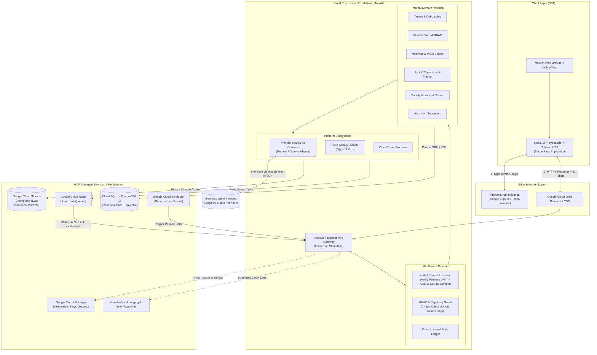
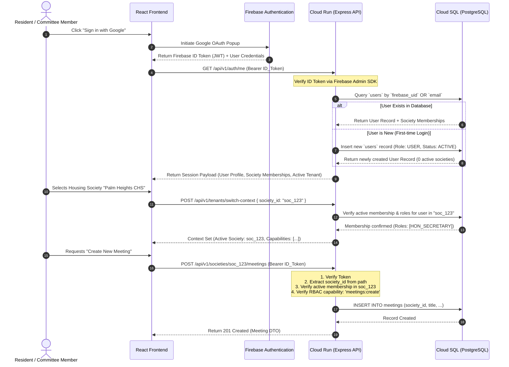

# SocietyFix AI — System Architecture & Technical Design

> **Document ID:** ARCH-001  
> **Status:** Approved / Milestone M0 Baseline  
> **Architecture Style:** Modular Monolith (Cloud Run Containerized Node.js + TypeScript)  
> **Infrastructure Target:** Google Cloud Platform (Cloud SQL, Cloud Storage, Cloud Tasks, Secret Manager)

---

## 1. Architectural Principles & Tenets

1. **Modular Monolith First:** Maintain a single deployable backend artifact with strictly decoupled internal domains (bounded contexts). Avoid microservices until team size or independent scaling requirements objectively demand distributed services.
2. **Strict Multi-Tenancy by Design:** The housing society is the root organizational tenant. Every business record belongs to a `society_id`. No query across tenant boundaries is permitted except by verified Platform Super Admins for platform operations.
3. **Double-Fence Authorization:** Authentication proves identity (Firebase Auth + Google Sign-In); authorization strictly verifies tenant context and internal role capabilities at the database and service layer. Client claims are never blindly trusted.
4. **Authoritative Ledger vs. AI Drafting:** AI models are treated as untrusted assistants. They draft, transcribe, extract, and recommend. Only human committee members commit authoritative state changes (resolutions, budget approvals, role grants).
5. **Exact Financial Numerics:** Floating-point data types (`FLOAT`, `DOUBLE`, `REAL`) are banned in financial calculations. All monetary fields use integer minor units (paise in INR) or fixed-precision `NUMERIC(14, 2)`.
6. **Defense in Depth & Auditability:** Every privileged action, document access, and role change produces an append-only audit trail with IP address, user ID, tenant ID, and state delta.

---

## 2. High-Level System Architecture



---

## 3. Component Details & Runtime Specifications

### 3.1 Frontend Web Application
- **Technology:** React 19, TypeScript 5+, Tailwind CSS v4, Lucide React (icons), Motion (fluid micro-interactions).
- **Build Tool:** Vite 8.
- **Hosting / Delivery:** Built static assets served by the Express server container in Cloud Run (monolith deployment) or via Google Cloud Storage + Cloud CDN in high-scale environments. In local development, Express mounts `vite.middlewares` via `tsx server.ts`.
- **State Management:** React hooks, custom context providers (`AuthContext`, `SocietyContext`, `NotificationContext`), TanStack Query (React Query) for server state caching and optimistic updates.
- **Form & Validation:** `react-hook-form` with `zod` schema validation sharing schemas with backend controllers.

### 3.2 Backend Modular Monolith
- **Runtime:** Node.js 22 LTS with TypeScript (`tsx` for dev, compiled ES2022 JavaScript for production).
- **Web Framework:** Express 4.x / 5.x with modular router topology.
- **ORM / Query Builder:** Drizzle ORM (type-safe SQL, zero runtime bloat, explicit migrations, native support for PostgreSQL types and `pgvector`).
- **Containerization:** Multi-stage `Dockerfile` (build stage with npm ci + tsc, production runtime stage with distilled node_modules and non-root unprivileged user `node`).
- **Compute Platform:** Google Cloud Run (Fully Managed, auto-scaling 0 to N, request-based concurrency up to 80, deployed in `asia-south1` Mumbai for minimal latency to Indian societies).

### 3.3 Database & Vector Storage
- **Primary Database:** Google Cloud SQL for PostgreSQL 16 (Enterprise or Developer edition).
- **Extensions:**
  - `uuid-ossp` or `pgcrypto`: For collision-resistant UUID v4 generation.
  - `pgvector`: For vector similarity search (768 or 1536 dimensional embeddings) enabling semantic search across minutes, resolutions, and circulars.
  - `btree_gist`: For exclusion constraints (e.g., overlapping meeting room reservations or parking slot allocations).
- **Connection Strategy:** Google Cloud SQL Node.js Connector with IAM database authentication or connection pooling via Google Cloud SQL Auth Proxy / PgBouncer.

### 3.4 Private Document Storage
- **Storage Service:** Google Cloud Storage (GCS).
- **Bucket Layout:** Single hardened, private bucket with hierarchical tenant prefixes:  
  `gs://societyfix-<env>-documents/societies/<society_id>/meetings/<meeting_id>/...`  
  `gs://societyfix-<env>-documents/societies/<society_id>/invoices/<invoice_id>/...`
- **Access Protocol:** Strictly zero public access. All file downloads and uploads utilize short-lived (15-minute) signed URLs generated by the backend only after validating tenant membership and RBAC permissions.

### 3.5 Asynchronous & Background Processing
- **Queue Engine:** Google Cloud Tasks.
- **Pattern:** HTTP Target Push Queues. The backend enqueues a task with a cryptographically signed payload; Cloud Tasks invokes the designated internal endpoint (`POST /api/internal/tasks/process-audio`, `POST /api/internal/tasks/dispatch-digest`) with exponential backoff and dead-letter queue (DLQ) support.
- **Scheduler:** Google Cloud Scheduler invoking Cloud Run authenticated endpoints with OIDC tokens for scheduled tasks (daily morning digest at 07:00 IST, AMC expiry checks, weekly maintenance reminders).

---

## 4. End-to-End Authentication & Authorization Lifecycle



---

## 5. Security & Isolation Architecture

### 5.1 Cross-Tenant Isolation Guarantee
Multi-tenancy isolation is enforced at four distinct layers:

1. **Routing Layer:** All society-scoped API endpoints require the tenant identifier in the path (`/api/v1/societies/:societyId/...`).
2. **Context Middleware:** The `tenantContextMiddleware` extracts `:societyId`, validates that the authenticated `user_id` has an active, non-suspended membership record for that exact `society_id`, and attaches the verified tenant context to `req.tenant`.
3. **Repository / Query Layer:** All database queries MUST include the filter `WHERE society_id = req.tenant.societyId`. Drizzle ORM helper query builders enforce this automatically via tenant-scoped scoped repository abstractions.
4. **Storage Layer:** Cloud Storage object paths incorporate the tenant ID prefix (`societies/:societyId/...`). The GCS signing service asserts that the requested resource path matches the authenticated tenant context before generating a signed URL.

### 5.2 Super Admin Boundary
- The **Platform Super Admin** is an exceptional administrative tier strictly reserved for platform engineers.
- Super Admin rights **cannot** be granted through any client API, user self-registration, or society invitation.
- Super Admins are designated exclusively via the `platform_admins` table seeded via secure migration scripts with Google Secret Manager-configured administrator email addresses.
- Super Admin actions are logged with heightened severity in Cloud Logging and trigger immediate alerts on security configuration changes.

---

## 6. Repository State Audit & Architectural Alignment

| Existing Repository Asset | Current Verified State | Architectural Decision in SocietyFix AI |
| :--- | :--- | :--- |
| `package.json` | React 19, Vite 8, Express 4, Tailwind CSS v4, `@google/genai` v2.4, Motion 12, Lucide React. | **Retain & Extend.** The core dependencies are perfectly aligned with our proposed modular monolith stack. We will add Drizzle ORM, `pg`, and testing utilities in subsequent milestones. |
| `.env.example` | Contains `GEMINI_API_KEY` and `APP_URL`. | **Align with Secret Manager.** Retain for local dev; in production, use Google Secret Manager mounted directly into Cloud Run environment variables. |
| `metadata.json` | Initialized with `SocietyFix AI` and server-side Gemini capability. | **Retained.** Fully compliant with Google Cloud / AI Studio hosting conventions. |
| `index.html` | Updated to SocietyFix AI title and metadata. | **Retained.** Entry point for Vite Single Page Application. |
| `src/App.tsx` | Minimal placeholder component (`<div></div>`). | **M0 untouched.** Will be built out in M2/M3 with authentication wrappers and routing. |
| Backend Server | No `server.ts` currently exists; `vite` runs directly. | **Adopt Modular Full-Stack Pattern.** In M1/M2, introduce `server.ts` mounting Express with `vite.middlewares` in dev and static serving in prod, preserving seamless full-stack execution on port 3000. |
| Database Layer | No database schema or ORM files present. | **Implement Drizzle ORM on Cloud SQL PostgreSQL** starting in M1/M2. |

---

## 7. Network Topology & Environment Segmentation

```mermaid
graph LR
    subgraph Development["Development Environment"]
        DevSPA[Dev Browser] --> DevCloudRun[Cloud Run (Dev Instance)]
        DevCloudRun --> DevCloudSQL[(Cloud SQL Dev DB)]
        DevCloudRun --> DevGCS[(Dev Storage Bucket)]
    end

    subgraph Staging["Staging Environment (Pre-Production)"]
        StagingSPA[QA / Staging Browser] --> StagingCloudRun[Cloud Run (Staging)]
        StagingCloudRun --> StagingCloudSQL[(Cloud SQL Staging DB)]
        StagingCloudRun --> StagingGCS[(Staging Storage Bucket)]
    end

    subgraph Production["Production Environment"]
        ProdSPA[Resident / Committee Users] --> ProdLB[Google Cloud Load Balancer / Armor WAF]
        ProdLB --> ProdCloudRun[Cloud Run (Prod Auto-Scaled)]
        ProdCloudRun --> ProdCloudSQL[(Cloud SQL HA Instance + Read Replica)]
        ProdCloudRun --> ProdGCS[(Prod Encrypted Bucket)]
    end
```

- **Environment Isolation:** Development, Staging, and Production maintain separate databases, storage buckets, and Secret Manager secrets.
- **Zero Inter-Environment Traffic:** Staging and Development instances cannot query Production databases under any circumstance.
- **Database Backup Strategy:** Automated daily Cloud SQL backups with point-in-time recovery (PITR) enabled for 7 days in Staging and 30 days in Production.
