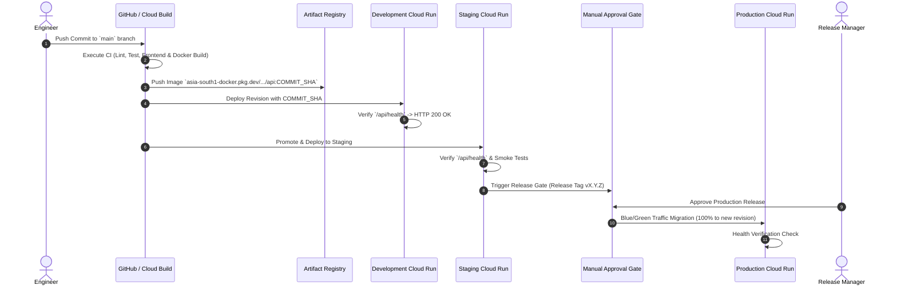

# SocietyFix AI — Deployment & Rollback Runbook

> **Document ID:** RUNBOOK-DEP-001  
> **Target Platform:** Google Cloud Run & Artifact Registry  
> **SLO:** Deployment rollback in under 60 seconds without data loss

---

## 1. Staged Deployment Flow



---

## 2. Production Deployment Checklist

### Pre-Deployment Checklist
- [ ] CI pipeline passed all automated unit tests, linting, and build steps.
- [ ] Database schema changes (if any) are backward-compatible (expand-and-contract pattern).
- [ ] New environment variables or secrets have been created in Google Secret Manager.
- [ ] No uncommitted or untracked changes exist in the release branch.

### Deployment Execution
```bash
# Deploy new revision with explicit commit SHA tag
export COMMIT_SHA="abc1234"
export REGION="asia-south1"

gcloud run deploy societyfix-prod-api \
    --image=asia-south1-docker.pkg.dev/societyfix-prod/societyfix-prod/api:${COMMIT_SHA} \
    --region=${REGION} \
    --platform=managed \
    --update-env-vars=GIT_COMMIT_SHA=${COMMIT_SHA}
```

### Post-Deployment Verification
```bash
# 1. Verify health probe
PROD_URL=$(gcloud run services describe societyfix-prod-api --region=${REGION} --format='value(status.url)')
curl -f -s "${PROD_URL}/api/health" | jq .

# 2. Check Cloud Logging for runtime crashes
gcloud logging read "resource.type=cloud_run_revision AND severity>=ERROR" --limit=20
```

---

## 3. Immediate Rollback Runbook (< 60 Seconds)

If the new production revision exhibits elevated 5xx errors, memory leaks, or database pool exhaustion:

### Method 1: Instant Traffic Shift via CLI (Fastest — 10 seconds)
Cloud Run maintains all previous immutable revisions. You can immediately route 100% of user traffic back to the prior known-healthy revision:

```bash
# 1. List recent revisions to identify the prior healthy revision ID
gcloud run revisions list --service=societyfix-prod-api --region=asia-south1 --limit=5

# Example output:
# REVISION                     ACTIVE  SERVICE             DEPLOYED
# societyfix-prod-api-00042-xyz  yes     societyfix-prod-api 2026-10-14 06:40:00 UTC (BAD)
# societyfix-prod-api-00041-abc          societyfix-prod-api 2026-10-13 18:00:00 UTC (HEALTHY)

# 2. Instantly route 100% of traffic to the healthy revision
gcloud run services update-traffic societyfix-prod-api \
    --to-revisions=societyfix-prod-api-00041-abc=100 \
    --region=asia-south1

# 3. Verify traffic shift
gcloud run services describe societyfix-prod-api --region=asia-south1 --format='value(status.traffic)'
```

### Method 2: Cloud Console 1-Click Rollback
1. Open **Google Cloud Console** > **Cloud Run**.
2. Select `societyfix-prod-api` > Click the **Revisions** tab.
3. Click **Manage Traffic**.
4. Set the previous revision to **100%** and the faulty revision to **0%**. Click **Save**.
