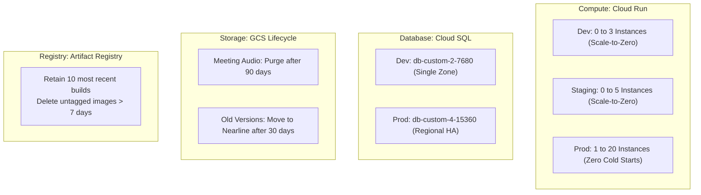

# SocietyFix AI — Reliability, Cost Controls & Disaster Recovery

> **Document ID:** OPS-COST-001  
> **Recovery Targets:** RTO (Recovery Time Objective) < 30 minutes, RPO (Recovery Point Objective) < 5 minutes

---

## 1. Resource Limits & Cost Controls Architecture

To prevent surprise billing and ensure disciplined resource utilization across all Google Cloud environments:

### 1.1 Resource Sizing Matrix

| Component | Development | Staging | Production | Cost Optimization Mechanism |
| :--- | :--- | :--- | :--- | :--- |
| **Cloud Run vCPU/RAM** | 1 vCPU / 1GB RAM | 1 vCPU / 1GB RAM | 1 vCPU / 1GB RAM | CPU allocated only during request processing (`cpu_idle = true`). |
| **Cloud Run Autoscaling** | 0 min / 3 max | 0 min / 5 max | 1 min / 20 max | Hard cap on max instances prevents runaway traffic billing. |
| **Cloud SQL Tier** | `db-custom-2-7680` (Zonal) | `db-custom-2-7680` (Zonal) | `db-custom-4-15360` (Regional HA) | Disk auto-resize enabled with baseline 20GB (Dev) / 50GB (Prod). |
| **Cloud Storage** | Standard (Zonal) | Standard (Zonal) | Standard (Regional) | Meeting audio deleted after 90 days; older versions moved to Nearline. |
| **Artifact Registry** | 10 image limit | 10 image limit | 10 image limit | Automated cleanup policy purges untagged intermediate Docker images. |

---

## 2. Google Cloud Budget Alerts Configuration

Budget alerts must be established in the Google Cloud Billing console. **Important:** Cloud budget alerts provide notifications when spending thresholds are approached; they do **not** represent hard spending caps that shut off services.

### Recommended Budget Thresholds
1. **Development Project:** $50 USD / month.
   - Alert Triggers: 50% ($25), 80% ($40), 100% ($50), 120% ($60).
2. **Staging Project:** $100 USD / month.
   - Alert Triggers: 50% ($50), 80% ($80), 100% ($100).
3. **Production Project:** $300 USD / month (Baseline for first 10 housing societies).
   - Alert Triggers: 50% ($150), 80% ($240), 90% ($270), 100% ($300).

---

## 3. Disaster Recovery (DR) Plan

### 3.1 Failure Modes & Recovery Strategies

| Disaster Scenario | Failure Probability | Impact | Recovery Procedure | Target RTO | Target RPO |
| :--- | :--- | :--- | :--- | :--- | :--- |
| **Zone Outage in Mumbai** | Low | Single-zone services degraded | Cloud SQL automatically fails over to secondary zone in `REGIONAL` mode. Cloud Run distributes instances across healthy zones. | < 2 minutes | 0 (Synchronous replication) |
| **Corrupted Database Records** | Medium (Human error) | Invalid accounting or deleted tasks | Point-in-time recovery (PITR) using continuous transaction logs to restore Cloud SQL to the second before corruption. | < 25 minutes | < 5 minutes |
| **Storage Bucket Accidental Deletion** | Very Low | Document files lost | Soft delete protection (7-day retention) allows undeletion via GCP console or `gcloud storage buckets undelete`. | < 10 minutes | 0 |
| **Container Build Regression** | Medium | Cloud Run 5xx errors | Instant revision shift back to previous known-good revision tag. | < 1 minute | 0 |

---

## 4. Disaster Recovery Drill Schedule

To verify that recovery procedures work under stress:
1. **Quarterly PITR Drill:** Restore production database backup to an isolated staging instance; verify row counts and table integrity.
2. **Monthly Rollback Drill:** Perform an intentional revision rollback in staging using `gcloud run services update-traffic`.
3. **Key Rotation Drill:** Rotate database passwords in Secret Manager and verify zero-downtime rolling restart.
