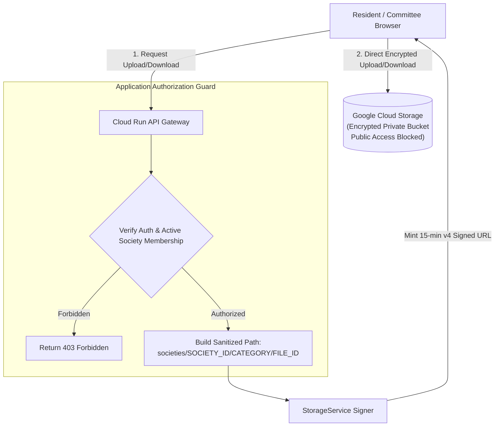

# SocietyFix AI — Private Storage & Document Security Policy

> **Document ID:** SEC-STORAGE-001  
> **Target Service:** Google Cloud Storage (GCS)  
> **Security Baseline:** Uniform Bucket-Level Access, Public Access Prevention Enforced, Tenant Prefix Scoping

---

## 1. Storage Architecture & Tenant Isolation

### 1.1 Mandatory Bucket Hardening
1. **Uniform Bucket-Level Access (`uniform_bucket_level_access = true`):** Disables object-level ACLs. Access is governed exclusively by IAM policies at the bucket level.
2. **Public Access Prevention (`public_access_prevention = "enforced"`):** Hard barrier at the GCP organization/project level. Prevents accidental bucket sharing or `allUsers` object grants.
3. **No Direct Public URLs:** Bucket objects cannot be read directly via `https://storage.googleapis.com/...` without cryptographic HMAC signatures.

---

## 2. Hierarchical Tenant Path Taxonomy

All objects stored in Google Cloud Storage follow a strict tenant-isolated directory structure:

| Document Category | GCS Path Template | Access Tier & RBAC | Retention & Lifecycle |
| :--- | :--- | :--- | :--- |
| **Meeting Audio** | `societies/{societyId}/meetings/{meetingId}/audio/{fileId}.m4a` | Committee Only (`HON_SECRETARY`, `CHAIRMAN`) | **90 Days** (Auto-deleted via GCS lifecycle rule) |
| **Meeting Minutes (MOM)** | `societies/{societyId}/meetings/{meetingId}/mom/{fileId}.pdf` | All Active Residents & Committee | Permanent (20+ Years) |
| **Vendor Invoices** | `societies/{societyId}/invoices/{vendorId}/{invoiceId}.pdf` | Treasurer, Secretary, Auditor | 8 Years (Statutory Tax Audit) |
| **Task Evidence** | `societies/{societyId}/evidence/{taskId}/{fileId}.jpg` | All Active Residents | 5 Years |
| **Resident Proofs** | `societies/{societyId}/memberships/{membershipId}/proof/{fileId}.pdf` | Committee Only (Verification) | Anonymized upon tenant move-out |
| **Society Bye-Laws** | `societies/{societyId}/documents/bye-laws/{fileId}.pdf` | All Active Residents | Permanent |

---

## 3. Signed URL Generation Protocol

1. **Pre-condition:** Client sends a request to `/api/v1/societies/:societyId/storage/signed-url`.
2. **Step 1 — Authenticate Identity:** Verify Bearer ID token via Firebase Admin SDK.
3. **Step 2 — Verify Active Tenant Membership:** Check `society_memberships` table where `user_id = token.uid` AND `society_id = :societyId` AND `status = 'ACTIVE'`. If status is `PENDING_APPROVAL`, reject with HTTP 403.
4. **Step 3 — Evaluate Category Capability:**
   - To read/write `meetings/*/audio`: Requires capability `meetings:record`.
   - To read/write `invoices/*`: Requires capability `finances:invoices:read` or `vendor:invoice:upload`.
5. **Step 4 — Sanitize Path:** Execute `StorageService.buildTenantPath(societyId, category, fileName)` to strip directory traversal (`../`) and illegal characters.
6. **Step 5 — Mint Short-Lived URL:** Generate signed URL valid for exactly 900 seconds (15 minutes).
